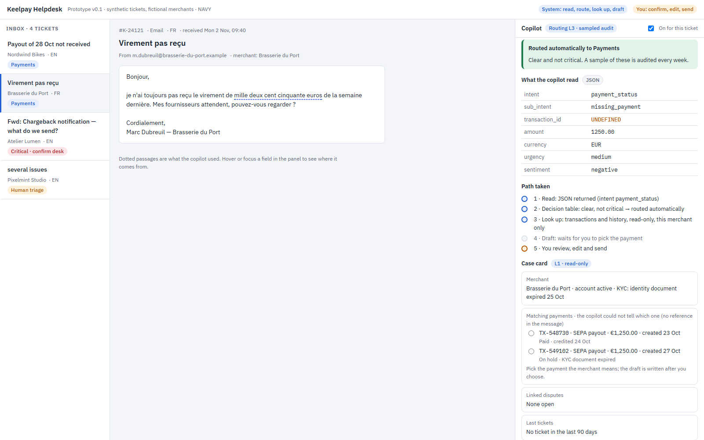

# 03 — Prototype link · Keelpay Support Copilot

> One clickable prototype of where your agent lives (the surface), made in under an hour, before Session 4.
> It is a question for users, not the product: fake data is fine; real customer data is not.

---

- **Link:** [Open the interactive mock-up](prototype/copilot_panel/index.html) (local standalone HTML/Tailwind prototype)
- **Tool:** Standalone HTML5 / Tailwind CSS interactive mock-up (executable in any modern browser)
- **Version:** v0.1 → v0.2 → v0.3
  - *v0.1:* 3-column static layout (inbox queue, active ticket message, copilot assistance card).
  - *v0.2:* Interactive field extraction with hover-to-highlight source passages in ticket text and side-by-side transaction candidate matching.
  - *v0.3:* Added queue wait-time counters (FIFO), explicit candidate selection confirmation, 1-click desk reroute, and explicit simulated send button.

---

## The prompt we used (the brief in three paragraphs)

```
Paragraph 1 — who uses it and for what job:
A Keelpay support agent (B2B payments fintech, ~36,000 merchant tickets a month in French and English) on one of four specialized desks (payments, disputes, technical / API, compliance). Job: get each ticket to the right desk and answer it on the right payment, without manually reading free-text messages and hunting for transactions in the ledger.

Paragraph 2 — what is on the screen (panels, buttons, the one thing it must never do):
Three columns: (1) ticket queue on the left with wait time and routing desk badge per ticket; (2) central ticket view with text passages highlighted on hover; (3) copilot side panel with extracted JSON fields (intent, sub_intent, transaction_id, amount, currency, urgency, sentiment), candidate transactions card, and a cited draft with numbered policy sources. Buttons: 1-click desk reroute and simulated Send. The copilot must never send autonomously or execute financial ledger writes: only the agent has a Send button.

Paragraph 3 — the rules (routing, what is “human only”, the trust level):
Deterministic rules route clear tickets automatically (L3); ambiguous or low-confidence tickets go to human triage (nothing guessed). High-urgency disputes or compliance tickets require a human to confirm the desk. Transaction lookups are read-only and scoped to the merchant (L1). Reply drafting is assist-only (L2, agent approves every reply). A rerouted ticket triggers draft recalculation once; a second reroute transfers to manual triage.
```

---

## Screenshot


