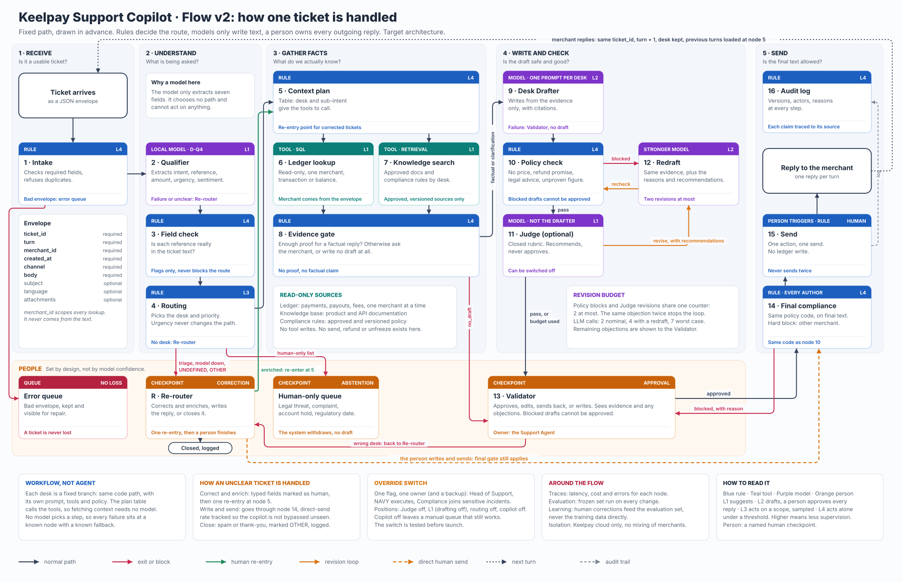

# 04 Architecture: Keelpay Support Copilot, decoded

Session 4. Target architecture validated on 6 November 2026. Working detail, with the measures of every node, is in [the node table](agentic-workflow-subproject/docs/design/flow-v2/node_table_v1.md); the build order is in [the task list](agentic-workflow-subproject/specs/013-flow-v2/tasks.md).

## 1. Workflow or agent, and why

**A workflow, not an agent.** The path is drawn in advance and each desk is a fixed branch with its own prompt, tools and rules. No model chooses a tool or a next step. The task decomposes into fixed sub-tasks (read, route, gather facts, draft, check, approve), and a person must be able to explain and switch off every step. Three more reasons:
- the cost per ticket is bounded (2 to 7 model calls);
- no tool can send, write to the ledger or refund, so the Chevrolet case (a bot committing the company) cannot happen;
- the only loop, draft and revise, is capped at 2 revisions.

## 2. Diagram

A ticket comes in as a typed envelope. A merchant reply keeps the `ticket_id` and raises `turn` by 1; later turns keep the desk and load the earlier turns. The two language models that always run are the Qualifier (node 2, local) and the Drafter (node 9); nodes 11 and 12 are optional revisions, kept only if measured.

## 3. Components, in order

Trust levels: L1 suggests, L2 drafts and a person approves every reply, L3 acts on a defined scope with sampling, L4 acts alone under a threshold. "Today" compares with the code in `agentic-workflow-subproject/flow/`.

| # | Component | Pattern | Level | Tool or model | Today | Main metric | Main risk |
|---|---|---|---|---|---|---|---|
| 1 | Intake | Rule-based | L4 | Rule | Partial | Share of tickets lost | A valid ticket refused |
| 2 | Qualifier | Routing, classifier step (rung 4) | L1 | Local LLM, D-q4 | Exists | Silent errors per 100 tickets: 0.7 | An urgent ticket sent to the wrong desk |
| 3 | Field check | Rule-based, chaining gate | L4 | Rule | To build | Wrong references caught | A valid format flagged as wrong |
| 4 | Routing | Routing on a rule | L3 | Rule | Partial | Re-router correction rate | The desk kept wrongly on later turns |
| 5 | Context plan | Rule-based routing | L4 | Rule | To build | Needed sources planned | A needed source not planned |
| 6 | Ledger lookup | Tool of the augmented LLM | L1 | Read-only SQL tool | To build | Exact, missing and ambiguous cases correct | Another merchant's record returned |
| 7 | Knowledge search | Tool of the augmented LLM | L1 | Retrieval tool | To build | Retrieval hit rate | A stale passage used |
| 8 | Evidence gate | Rule-based, chaining gate | L4 | Rule | To build | `factual` decisions that had enough evidence | A factual reply without enough evidence |
| 9 | Desk Drafter | Routing, prompt chaining | L2 | LLM | Partial | Drafts sendable as is | An unsupported claim or promise |
| 10 | Policy check | Rule-based, chaining gate | L4 | Rule | To build | Seeded violations caught | A violation missed |
| 11 | Judge (optional) | Evaluator-optimizer | L1 | Other LLM | To build | Sendable gain per revision | Good drafts rejected, extra cost |
| 12 | Redraft | Evaluator-optimizer | L2 | Stronger LLM | To build | Revised drafts that become sendable | A revision worse than the draft |
| R | Re-router | Human checkpoint | Human | Person | Backend only | Correction time | An urgent ticket waiting in the queue |
| 13 | Validator | Human checkpoint | Human | Person | Backend only | Review time | Approval without reading |
| 14 | Final compliance gate | Rule-based, last gate | L4 | Rule | To build | Real issues stopped on the final text | A violation in a human text missed |
| 15 | Send | Rule-based action | Human trigger | Rule | To build | Duplicate sends: 0 | A reply sent twice |
| 16 | Audit log | Rule-based | L4 | Rule | Partial | Tickets with a complete history | Personal data in logs |

**For the whole system.** Metric: drafts sendable as is, with the quality-assurance (QA) score held constant. Main risk: a wrong payment fact approved without a real review.

**Notes on the levels.** The Qualifier is L1 because rules check its output and it never acts; the Routing rule is L3, with a weekly QA sample of 5 % of routed tickets (assumption). The tools and the Judge are L1: they read or recommend and never act. A silent error is a ticket routed with a wrong desk or a wrong `transaction_id`, `amount` or `currency` and no flag. The Qualifier makes 0.7 per 100 on `test_natural`, but 1 urgent ticket in 167 (0.6 %) still lands in a wrong desk; our own criterion in `03_product_brief.md` asks for zero, so this stays a known gap until the weekly QA sample and the Re-router catch it.

**Rungs.** Rules are the lowest rung of the course ladder. The Qualifier is a custom fine-tuned model: the rung below (B2) made 33.9 silent errors per 100 against 0.7 for D-q4. Nodes 9, 11 and 12 use a pretrained model, because rules or templates cannot answer free-form payment questions and a classifier cannot generate text. Thresholds are set on validation data, never on the frozen evaluation set.

## 4. Tools

The tools are read-only and scoped to the `merchant_id` of the envelope, never read from the text; none can send, write or refund. Tier 1 uses stubs returning `unavailable` so the flow runs end to end; tier 2 (the demo) uses a mini synthetic ledger, knowledge base and compliance rules; tier 3 deploys them as a bonus. The contracts are the same in all tiers. In the target, the models run in Keelpay's cloud; the external API used for the demo sees synthetic data only.

## 5. Human checkpoints

The deck has two kinds: **approval** before something is sent, and **abstention** when the system hands over. Each has an owner and a service level. Service levels are assumptions to confirm with the Head of Support, counted within support hours (to define), with an alert on queue age.

| Checkpoint | Kind | Owner | Service level | Actions |
|---|---|---|---|---|
| Re-router (R) | Abstention and correction | Support Agent | Urgent: 1 hour. Others: 1 working day | Correct and enrich once, write and send, or close with a reason |
| Human-only queue | Abstention | Senior Support Agent, with Compliance | Urgent and regulatory deadline: 1 hour. Others: 4 working hours | Handle the ticket without a draft |
| Validator (13) | Approval | Support Agent | Urgent: 1 hour. Others: 1 working day | Approve, edit, send back for one redraft, or write |
| Send (15) | Approval, human trigger | Support Agent | At approval | Simulated send, once |

**Human-only list (proposal):** a legal threat; a formal complaint, since in payments these carry regulated deadlines; an `account_hold`; a regulatory deadline; a refund, compensation or fee-waiver request; suspected fraud or account takeover; a data-protection (GDPR) request. In the target these go to the Human-only queue, which is in the architecture but not built in the first version. **In the first version, a keyword rule sends them to the Re-router with no draft.**

A person can take any ticket back at any time. Nothing is sent without a person, and every text, written by a model or a person, passes the final compliance gate. A person who writes directly skips the Validator step, so the direct-send rate is tracked. The model is never trusted with three things: sending, writing to the ledger or moving money, and quoting a figure that is not in the evidence.

## 6. Override switch

**The switch** is one flag, `copilot_mode`, owned by the Head of Support, with a named backup (the deputy head of support). Its positions run from light to total:

| Position | Effect |
|---|---|
| Judge off | The optional revision loop stops; policy blocks still apply |
| **L1: drafting off** | No draft is prepared; qualification and context stay as suggestions, a person writes, nothing is sent by the copilot |
| Routing off | Tickets are routed by hand; the Qualifier output is only a suggestion |
| Copilot off | Every ticket goes to a manual queue that works without the copilot |

**When to pull it:** one serious error sent to a merchant, an urgent ticket found in a wrong desk by the weekly QA sample, or a policy rule failing in production. The Head of Support triggers it, the NAVY team executes it within the service level of the Re-router, and Compliance joins sensitive incidents.

**Test before any demo or launch:** run the evaluation set with the flag at L1 and check that no draft is produced and nothing is sent; record the result. "Unplug the bot" is not a switch.

## 7. Limits that bound the system

- **Shared revision budget:** policy blocks and Judge recommendations use one counter, 2 at most; the loop stops earlier if the same objection returns. A draft still blocked after the budget cannot be approved, and the person writes.
- **Turn limit:** from turn 4 on one ticket (proposal, set in the configuration), the ticket goes to the Re-router. Turns per ticket are tracked as the counter-metric to closure speed.
- **No evidence, no factual claim:** the Evidence gate chooses between a factual reply, a clarification and no draft.
- **Failures:** invalid input goes to an error queue; Qualifier failure, `OTHER` or `UNDEFINED` go to the Re-router; if the Drafter is down, the ticket reaches the Validator with its context and no draft; spam and thank-you notes are closed by a person.
- **Calls per ticket:** 2 model calls in the nominal case with the Judge off, 3 with one Judge call, 4 when a policy block triggers a redraft even without the Judge, 7 in the worst case (Qualifier, Drafter, 3 Judge, 2 Redraft). One of them, the Qualifier, is local.

## 8. Built today and target

Built: the Qualifier (D-q4, measured), the routing rule, a first Drafter and part of the audit log. To build, in order: measures, the ticket envelope and turns, context plan and Evidence gate with stubs, policy check and final gate, the per-desk Drafter, the tier-2 tools, human actions and Send, the API and screens, then the optional Judge and the switch. No endpoint is deployed.
