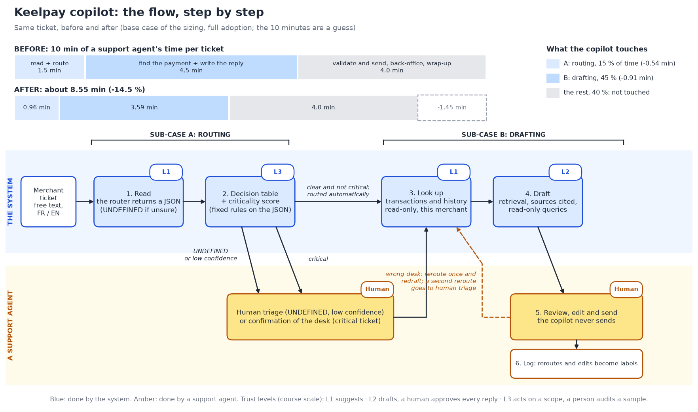

# NAVY — Keelpay agent-assist copilot

**Course:** Data & AI Product: From Diagnosis to Delivery (MSA-DAT07-04) · Albert School · shared project with Agentic Workflows
**Cohort:** M2-INTER-2

## Team
| Name | Git handle | Also in the Agentic Workflows team? |
|---|---|---|
| Alexandre Waerniers | Xenodion | yes |
| Vincent Lamy | Vincent-20-100 | yes |
| Nahel Bachiri | nahelbachiri-oss | yes |
| Yoni Mahieddine | InoyDev | yes |

## Our agent: the frozen brief (read this first)

> **Source of truth.** This section is the definitive starting brief of NAVY, frozen on 30 October 2026. Every other file must be consistent with it. If a file disagrees (numbers, company, scope), the file is wrong, not this section. Change this section only with the whole team's agreement, then update the files below in the same commit.

We keep from the course proposal P2 only the universe: a B2B payments fintech, an agent-assist copilot that drafts and never sends, a human who validates, trust level L2. The company, scale, pain, job, metric and trap are our own.

### Words we use (the course uses "agent" for two different things)

| Term | Means | Not to be confused with |
|---|---|---|
| **Support agent** | A Keelpay employee who handles tickets | an AI agent |
| **Copilot** | The system we specify: a model plus fixed rules plus a screen. It prepares the case and a draft and never sends. It is what the course calls the "Agent's job" | a support agent; an AI agent |
| **Model** | The small fine-tuned language model inside the copilot: it reads the free-text message and returns a structured JSON | the copilot as a whole; the drafter |
| **Routing / Drafting** | The two sub-cases of the copilot: sending the ticket to the right desk, and preparing the reply | |
| **AI agent** (agentic) | A system that chooses its own steps and calls tools in a loop. We do not build one in the first version: the copilot follows fixed steps | support agent |
| **Desk** | One of the specialist teams a ticket is routed to (payments, disputes, technical, compliance) | the NAVY project team |
| **Merchant** | A Keelpay customer; the person who writes the ticket | |
| **NAVY team** | Us, the four students | |

### Keelpay · Agent-assist copilot for a B2B payments fintech

| | |
|---|---|
| **Company** | Keelpay: ~2,500 merchant customers (SMEs and mid-size, France and Belgium), ~36,000 tickets a month in French and English, mostly payment status, disputes, technical / API and compliance questions. |
| **Pain** | Tickets arrive as free text, mostly by email. A support agent must work out what the message is about and send it to the right desk (~15 % of handling time), then find the payment and its history and write the reply (~45 %). Roughly 1 ticket in 7 first lands in the wrong desk and loses a hand-over. |
| **The copilot, end to end** | No customer-facing autonomy. One flow in two sub-cases that depend on each other: the draft is only worth writing if the ticket is in the right desk. A support agent reviews every draft and sends it. |
| **Sub-case A · Routing** | A fine-tuned model reads the message and returns a structured JSON (type of request, payment, amount, urgency); fixed rules (a decision table on the JSON) send the ticket to a desk. Shorter in time but more critical: an error costs a hand-over, and an urgent ticket in the wrong desk misses its deadline. Applied automatically; anything the model cannot determine is `UNDEFINED`, and low-confidence or critical tickets go to a support agent for triage first. Trust level: L3, with sampling (to confirm in governance). |
| **Sub-case B · Drafting** | Once the ticket is in the right desk, the copilot retrieves the matching transactions and history (read-only, limited to the merchant), reads the relevant policies, and drafts the reply with its sources cited (retrieval-augmented generation, plus read-only database queries). Longer in time but less critical: a support agent reads and edits every draft. Trust level: L2. A ticket found misrouted at this stage is rerouted by the support agent and redrafted in the right desk, once; a second reroute goes to human triage. |
| **Data constraint** | Tickets carry merchant and payment data and never leave Keelpay's own cloud: no external model API, for the router or the drafter. All models run in Keelpay's private cloud. Given by the scenario (Keelpay's compliance policy), not a guess. |
| **Primary metric** | Average handling time per ticket, end to end, at constant quality (QA score). Handling time is hands-on time and excludes queue waiting. Counter-metrics: share of urgent tickets that reach the wrong desk; drafts on the wrong payment that are validated unread. Each sub-case also has its own diagnostic metrics (first-time-right routing; draft edit rate). |
| **The trap** | A misread message looks handled: an urgent ticket (dispute deadline, compliance hold) sits in the wrong desk, or a confident draft is built on the wrong payment. When unsure, the copilot must say so rather than guess. |
| **Innovative angle** | Anything the copilot cannot determine is marked `UNDEFINED` and left to the support agent, not guessed; the support agent can open any ticket and see what the copilot read and which path it took. Our A/B alternates copilot-on and copilot-off weeks for the same support agents, not for tickets, because the ticket mix changes day to day. |

### The flow & architecture: dual-node workflow and decision trees

The copilot follows a continuous two-stage pipeline designed for maximum human efficiency. Clear tickets flow directly from Node 1 into DB Lookup and Node 2 Drafter (Trust L3) without requiring an intermediate human routing checkpoint. The support agent performs a single unified review (Trust L2) of both the routing and the cited draft in their workspace. On the ~2% misrouted tickets, the agent triggers a 1-click reroute with automatic re-drafting:

```mermaid
flowchart TD
    classDef llm fill:#e1f5fe,stroke:#0288d1,stroke-width:2px;
    classDef human fill:#fff3e0,stroke:#f57c00,stroke-width:2px;
    classDef system fill:#f3e5f5,stroke:#7b1fa2,stroke-width:2px;
    classDef alert fill:#ffebee,stroke:#d32f2f,stroke-width:2px;

    Start(["📥 Incoming Merchant Ticket<br/>(Email / Free-text in FR or EN)"]) --> N1

    subgraph SUB_A ["NODE 1: ROUTER & DECISION TABLE (Sub-case A · Trust L3)"]
        N1["🤖 Node 1: Router SLM (System 1)<br/>(Qwen2.5-3B-LoRA / GGUF CPU)"]:::llm
        N1 --> D1{"Valid JSON &<br/>Recognized Intent?"}
        
        D1 -- "Invalid, OTHER or UNDEFINED" --> Triage["👤 Human Triage Queue<br/>(Support Agent L1)"]:::human
        
        D1 -- "Valid JSON Schema" --> D2{"Decision Table:<br/>Criticality & Target Desk"}
        
        D2 -- "Dispute / Compliance & HIGH urgency" --> QueueCritical["🚨 Critical Queue<br/>(Held for confirmation)"]:::alert
        D2 -- "Clear & Standard" --> AutoRoute["⚡ Automated Routing (Trust L3)<br/>(Payments, Disputes, Tech, Compliance)"]:::system
        
        Triage -- "Manually routed" --> D2
    end

    subgraph SUB_B ["NODE 2: COPILOT DRAFTER & RAG (Sub-case B · Trust L2)"]
        AutoRoute & QueueCritical --> FetchData["🔍 1. Read-Only DB Lookup<br/>(Candidate transactions & merchant card)"]:::system
        FetchData --> FetchKB["📚 2. Knowledge Retrieval (RAG)<br/>Desk policy chunks [KB-xxx]"]:::system
        
        FetchKB --> N2["🤖 Node 2: Drafter LLM (System 2)<br/>(Prompted model + citations)"]:::llm
        
        N2 --> Guardrails{"3. Automated Guardrails:<br/>- Citations valid?<br/>- No illegal commitments?"}:::system
        
        Guardrails -- "Pass" --> DraftReady["📝 Cited Draft Ready"]:::system
        Guardrails -- "Missing facts / doubt" --> FlagDraft["⚠️ Draft with Warning<br/>'[VERIFICATION NEEDED]'"]:::alert
    end

    subgraph HUMAN_LOOP ["UNIFIED HUMAN-IN-THE-LOOP (Trust L2 · Never sends autonomously)"]
        DraftReady & FlagDraft --> UI["🖥️ Desk Support Agent Workspace (Chainlit)<br/>(Ticket + Extracted JSON + DB facts + Cited Draft)"]:::human
        UI --> AgentReview{"Single Unified Review:<br/>Routing & Draft accurate?"}:::human
        
        AgentReview -- "Accurate (98%)" --> AgentAction["👤 Support Agent edits if needed<br/>& clicks Send"]:::human
        AgentAction --> Sent(["📤 Sent to Merchant"])
        
        AgentReview -- "Misrouted (~2%)" --> Reroute["🔁 1-Click Reroute<br/>(Redrafted once, 2nd to triage)"]:::human
        Reroute --> D2
    end
```

#### Comparison of the two nodes

| Characteristic | Node 1: Router & Qualifier | Node 2: Copilot Drafter |
|---|---|---|
| **Sub-case** | Sub-case A (Routing & Qualification) | Sub-case B (Drafting & Retrieval) |
| **Model type** | Fine-tuned SLM (Qwen2.5-3B-LoRA / GGUF CPU) | Prompted LLM + RAG (Knowledge Base & DB) |
| **Input** | Raw ticket text (French / English) | Ticket + Node 1 JSON + DB facts + KB chunks |
| **Output** | Strict JSON object (7 fields) | Formatted email draft with citations `[KB-xxx]` |
| **Free-text generation** | **Strictly prohibited** (JSON output only) | Permitted, grounded in retrieved facts |
| **Abstention rule** | Fills `"UNDEFINED"` when uncertain → Human triage | Inserts `[VERIFICATION NEEDED]` → Agent check |
| **Trust level** | **L3** (automatic routing, with QA sampling) | **L2** (human reviews and edits every draft) |
| **Data locality** | Runs inside private infrastructure (CPU/GCS) | Runs inside private infrastructure / hosted mock |

#### Cognitive architecture: Kahneman's System 1 vs System 2 & TypeSafe AI's "Jev"

The dual-node division reflects the cognitive dichotomy formalized by Daniel Kahneman (*Thinking, Fast and Slow*):

* **System 1 (Fast, instinctive, structured, low-cost): Node 1 Router SLM**
  * Operates like the emerging industry category of *"System One models"* (formalized by TypeSafe AI with its proprietary model *Jev*, launched in September 2026).
  * System 1 models do not author free-text narrative; they take raw communication states and emit deterministic, typed schemas (Pydantic objects) with confidence indices.
  * *Why build an in-house fine-tuned SLM instead of commercial System 1 APIs like Jev?*
    1. **European Banking Secrecy & DORA/GDPR:** Keelpay's financial emails (IBANs, chargebacks, dispute amounts) cannot be streamed to third-party US proprietary APIs. The model runs within Keelpay's private cloud.
    2. **Dynamic Entity Extraction:** While pure System 1 classifiers only select from predefined categorical answers, our Router SLM also extracts unstructured entity variables (`transaction_id`, `amount`, `currency`).
    3. **Unit Economics & Zero Lock-in:** The quantized model (D-q4) operates on an 8 vCPU instance for < 18 €/month on 36,000 tickets, eliminating variable per-ticket API tolls and vendor lock-in.
* **System 2 (Deliberative, analytical, narrative, verified): Node 2 Drafter LLM**
  * Handles contextual synthesis: cross-referencing merchant history, retrieving policy articles (RAG), and drafting human-readable prose verified by explicit policy guardrails.

#### The four decision trees & guardrails

1. **Decision Tree 1: Schema Integrity & Abstention**
   * The model extracts: `intent`, `sub_intent`, `transaction_id`, `amount`, `currency`, `urgency`, `sentiment`.
   * If parsing fails or any essential field is `"UNDEFINED"` → **Zero guess:** the ticket is routed directly to a Level-1 Support Agent for manual triage.
2. **Decision Tree 2: Desk Routing Table**
   * Valid JSON is mapped deterministically to one of four specialized desks:
     * **`payments`**: Status of transfers, SEPA delays, missing payouts, refund tracking.
     * **`disputes`**: Chargebacks, suspected fraud, legal notification windows.
     * **`technical`**: API keys, HTTP errors (4xx/5xx), CMS plugins (Shopify, WooCommerce), webhook failures.
     * **`compliance`**: KYC onboarding, identity proof verification, AML regulatory account holds.
3. **Decision Tree 3: Urgency & SLA Escalation**
   * If `urgency == "HIGH"` (e.g. chargeback deadline within 24h, regulatory block, churn risk) → Ticket enters the high-priority queue with immediate agent SLA.
4. **Decision Tree 4: Drafter Grounding & Policy Guardrails**
   * **Read-only lookup:** Transactions are attached by strict matching on the merchant's account. No cross-merchant access.
   * **Grounded citations:** The drafter must cite the exact knowledge base section (`[KB-xxx - Section]`).
   * **Negative constraints:** The drafter cannot promise refunds, waive transaction fees, or make binding legal commitments. If an answer cannot be proven from retrieved chunks, it writes `[VERIFICATION NEEDED]`.
5. **Human-in-the-Loop Contract:**
   * **The copilot never sends an email autonomously.**
   * A human support agent reads the draft, reviews citations, adjusts phrasing, and clicks "Send".
   * If the agent discovers a misrouted ticket at this stage, they reroute it once (the ticket is redrafted in the target desk); a second misroute automatically falls back to manual triage.

### Starting numbers (given by the scenario)

These are the company's own figures in our fictional case, the way a ticket log and the finance team would give them in real life. They are the fixed starting base, not hypotheses.

| Number | Value |
|---|---|
| Merchants | ~2,500 |
| Tickets a month | ~36,000 |
| Share of handling time spent reading and routing (sub-case A) | ~15 % |
| Share of handling time spent finding the payment and history, and writing the reply (sub-case B) | ~45 % |
| Rest of handling time, not touched by the copilot: validating and sending, back-office actions, wrap-up | ~40 % |
| Tickets first routed to the wrong desk | ~1 in 7 (about 15 %, ~5,100 tickets a month) |
| Languages | French, English |

Every other number (handling time, team size, costs, benefits, share of tickets handled automatically, cost of a triage) is derived bottom-up in the S2 sizing from these, tagged measured / analogy / guess (the course's tags), and never copied from the course examples (Paylio, the sample brief). The copilot shrinks the time spent in A and B, it does not remove it: the gain is the reduction in each slice, and the drafting gain only materialises on tickets that were routed correctly.

### Role of the fine-tuned model, and the sub-project

The model is a small language model fine-tuned to read the free-text ticket and return a strict JSON (`intent`, `sub_intent`, `transaction_id`, `amount`, `currency`, `urgency`, `sentiment`); anything ambiguous is `UNDEFINED`. It serves sub-case A only; the drafter is a prompted model with retrieval, not fine-tuned. The model is built in `/finetuned_llm_classifier` for the Agentic LLMOps course (its own uv project, see its README). The only interface between the copilot and that folder is the JSON schema: no cross imports. Details of the decision table, the criticality score and the thresholds are defined later (S3, S4), not here. A fine-tuned model has to be compared with the other options (deterministic rules, classical ML, a prompted open-source model, all inside Keelpay's cloud) on effectiveness, latency and cost, and is kept only if it wins (see `01_problem_statement.md`).

### How we position the decision (staged go)

The sizing (`02_sizing.xlsx`, Decision tab) gives the full copilot a positive expected value and a CONDITIONAL GO (the pessimistic, slow-rollout case loses money), but the result hinges on three numbers we can only measure: total time saved, incremental serious errors, and how well the router reads. So the decision is staged. **Stage 1, GO:** rules-only ticket-to-transaction attach (no AI); it is also the copilot's lookup layer. **Stage 2, CONDITIONAL GO:** add the fine-tuned router and the drafter, conditional on the S4 gold-set experiment (thresholds in `01_problem_statement.md` section 8). The fine-tuning project in `/finetuned_llm_classifier` is that experiment: it produces the evidence for the router, and a negative result (the prompted model is as good) is a valid outcome.

### Rules for anyone (human or AI assistant) editing this repo

- Do not reuse numbers, names or conclusions from the course's example brief or from the course documents in `docs/`.
- Do not add scope beyond the table above (no autonomous sending, no AI agent in v1, no extra channels) without team agreement.
- A derived number without a tag (measured / analogy / guess) and, for a guess, a test does not belong in the files. The five starting numbers are given by the scenario and need no test.

## Repository structure
One numbered file per session. Every member authors commits in at least four of the numbered files.

| File | Session | Status |
|---|---|---|
| `00_pitch.md` | before S3 — our redefined case | filled |
| `01_problem_statement.md` | S1–S2 — Assignment 1 | v1 |
| `governance.md` | created for Assignment 1, one line added every session | Sessions 1–3 filled |
| `02_sizing.xlsx` | S2 — Assignment 2 | v1 — filled, conditional go |
| `02_investment_memo.md` | S2 — Assignment 2 | v1 — conditional go (staged) |
| `03_product_brief.md` | S3 — Assignment 3 | v1 — v2 (sections 9–10) after the usability test |
| `03_ai_lean_canvas.md` | S3 — Assignment 3 | v1 |
| `03_user_research.md` | S3 — Assignment 3 | desk research done; usability test to run |
| `03_prototype_link.md` | S3 — Assignment 3 | v0.1 — screenshot to add |
| `04_architecture.md` | S4 | to do |
| `05_metrics.md` | S5 | to do |
| `06_ab_protocol.md` | S6 | to do |
| `07_operations.md` | S7 | to do |
| `08_launch_memo.md` | S8 | to do |
| `spec.md` | S3 skeleton, final in S4 | skeleton v0 — one decision open (drafter bar) |
| `product_brief.md` | final | to do |
| `/prototype` | from S3 | static mock of the panel v0.1 (`copilot_panel/`); code from S4 |
| `/evals` | from S3 | `eval_set_v0.csv`, 20 tickets labelled by hand |
| `/finetuned_llm_classifier` | Sub-project of the course "Agentic Workflows & LLM Ops" (own uv environment, see its README) | in progress |

## Rules
- Commit with your own Git account: the individual question at the oral is about a commit you signed.
- Tag the final version `v1.0` before the first oral of your cohort. No commits after the first oral starts.
