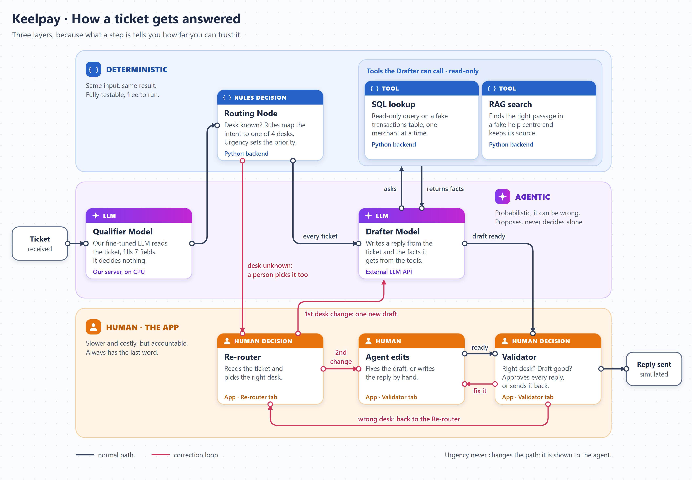

# NAVY — Keelpay Support Copilot

**Data & AI Product: From Diagnosis to Delivery — MSA-DAT07-04** · Albert School · M2-INTER-2. Shared project with Agentic Workflows & LLMOps. Working reference: 3 November 2026.

| Team member | Git handle |
|---|---|
| Alexandre Waerniers | Xenodion |
| Vincent Lamy | Vincent-20-100 |
| Nahel Bachiri | nahelbachiri-oss |
| Yoni Mahieddine | InoyDev |

## Product and decision

When a merchant ticket arrives, the copilot qualifies it, assigns known requests through deterministic rules, retrieves authorized context, and prepares a sourced reply or clarification. A Support Agent corrects the desk when it is unclear or wrong (Re-router), checks every reply (Validator), and explicitly triggers each send. No autonomous send, refund, account unfreeze, or ledger write.

**GO to build and evaluate the demo; CONDITIONAL GO for a Keelpay pilot.** Expansion depends on end-to-end evidence at constant quality. Deterministic context attachment without AI is an alternative to test, not a delivered project.

## Shared scenario

Keelpay is a fictional B2B fintech with about 2,500 merchants in France and Belgium, 36,000 monthly tickets, mostly in French and English. Scenario inputs: reading/assignment uses 15% of active handling time; lookup/context/drafting 45%; other actions/review/send 40%. One in seven tickets first reaches the wrong desk, equal to 14.286% or about 5,143 tickets at this volume. These are fictional starting data, not observations by our team.

Ten minutes per ticket, 46 agents, costs, growth, adoption, and savings are assumptions in [the sizing workbook](02_sizing.xlsx). Active handling time excludes queue wait, which is measured separately.

The canonical names are **Qualifier Model** (seven-field extractor), **Routing Node** (deterministic Python decision), **Lookup Node**, **Retrieval Node**, **Drafter Model**, **Support Agent** (human), **Demo Injector** (Python script), and **Langfuse** (observability). See [the terminology reference](agentic-workflow-subproject/docs/design/terminology.md).

## Reference flow

This is the target flow; it is not built yet. Steps are grouped by what they are, because that tells you how far you can trust them: deterministic Python rules and tools give the same result every time, the LLMs can be wrong so they only propose, and the Support Agent has the last word in the app. The Qualifier Model only extracts fields. Only the Drafter Model calls tools, and the first version drafts without them.

Demo Injector → Qualifier Model → Routing Node → Drafter Model (calling the Lookup Node for SQL and the Retrieval Node for RAG) → Validator → simulated send. An unclear or wrong desk goes to the Re-router while the draft is still prepared. An unidentified payment may require selection or clarification; unknown sentiment does not block routing. Priority alone does not block draft preparation.

Bounded L3 assignment, assisted lookup/context, L2 reply, human send. The first desk correction triggers one new draft; after a second change, the Support Agent fixes the draft or writes the reply by hand. Do not automatically split multi-intent tickets.

Three target tabs: **Overview**, **Re-router**, and **Validator**. Clicking a human node opens an eligible task. Waiting time and oldest-first are MUST for the demo; advanced urgency and multi-agent are SHOULD. Overview reflects backend events; Langfuse observes processing but does not store operational queues.

## Demo and fictional production are separate

| Environment | Boundary and evidence |
|---|---|
| Benchmark | Synthetic tickets, contract, and historical Qualifier Model results; component evidence only |
| Course demo | Static front end, Cloud Run CPU backend, synthetic ledger/KB, external Drafter Model and Langfuse permitted only on non-critical synthetic data; simulated sends |
| Fictional production | Real tickets, models, and traces remain in Keelpay cloud under the scenario's internal policy; architecture, compliance, and value require validation before any pilot |

The Qualifier Model schema is [schema.py](agentic-workflow-subproject/ml/qualifier/src/dataset_build/schema.py), with semantics in [label_definitions.md](agentic-workflow-subproject/docs/label_definitions.md). All seven values are strings; an absent reference/amount/currency is empty string, ambiguity is `UNDEFINED`, and out-of-taxonomy intent/sub-intent is `OTHER`. The contract has no confidence score or `critical` urgency. `UNDEFINED` blocks only decisions that depend on that field.

## Current state and evidence

The [LLMOps sub-project](agentic-workflow-subproject/README.md) has 3,205 accepted tickets (1,922 train, 293 validation, 610 natural test, 380 traps). D-q4 has four silent errors on 610 and one wrong-desk case among 167 urgent tickets in the historical scorer. That scorer derives desk from intent; it does not yet measure the full product policy. The prompted base model B3 (same Qwen 3B, no fine-tuning) is scored on validation and both test splits: 10.5 silent errors per 100 on test_natural, but only 60 % valid JSON and 43 % of tickets routed by itself, so fine-tuning is what makes the Qualifier Model usable. Recovery status is tracked in [LLMOps tasks](agentic-workflow-subproject/docs/llmops_recovery_tasks.md). Vertex registration is reported in the logs; no current cloud state is certified here.

The original V0 is the clickable static mock-up in [prototype/copilot_panel/index.html](prototype/copilot_panel/index.html), with its [screenshot](prototype/prototype_K-24121.png). It uses synthetic tickets and does not represent a live integrated service. The functional V1 experience, Routing Node, persistent backend, three-tab workflow, and demo deployment remain to be built. Ticket messages stay in their authored languages.

## Current documents

- [Pitch](00_pitch.md), [problem statement](01_problem_statement.md), [investment memo](02_investment_memo.md), [product brief](03_product_brief.md), [lean canvas](03_ai_lean_canvas.md).
- [Simulated user feedback and validation plan](03_user_research.md), [original V0 mock-up and V1 target](03_prototype_link.md), [governance](governance.md).
- [Product specification](spec.md), [architecture reference](agentic-workflow-subproject/docs/design/architecture.md), [workflow and detailed UX](agentic-workflow-subproject/docs/design/copilot-workflow.md), [terminology](agentic-workflow-subproject/docs/design/terminology.md), [synthetic evaluation cases](evals/README_eval_set.md).
- [Delivery roadmap](agentic-workflow-subproject/specs/roadmap.md) and the future [Routing Node contract](agentic-workflow-subproject/specs/004-routing-node/spec.md).
- Original course briefs and supplied materials are preserved under `docs/assignment*`, `docs/project` and `docs/_archive`.

Deliverables 05 metrics, 06 A/B, 07 operations, 08 launch, and final synthesis remain to be produced from their course instructions. The course asks for at least four numbered files per member and a final v1.0 tag before the oral presentation.
