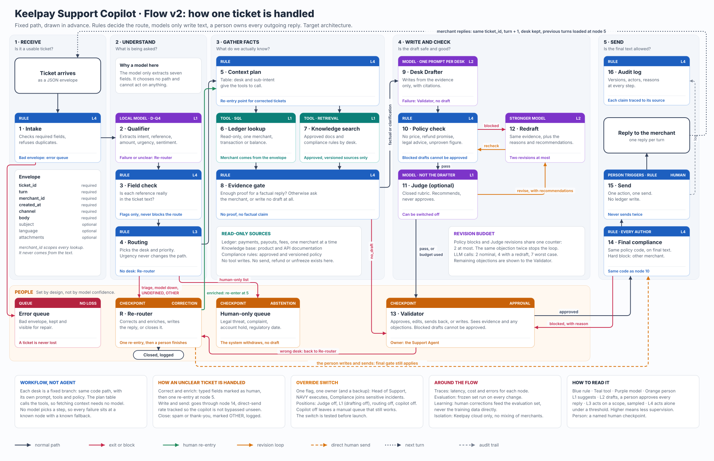

# NAVY — a support copilot that routes and drafts

**Course:** Data & AI Product: From Diagnosis to Delivery (MSA-DAT07-04) · Albert School · shared project with Agentic Workflows & LLMOps
**Cohort:** M2-INTER-2

## Team

| Name | Git handle | Also in the Agentic Workflows team? |
|---|---|---|
| Alexandre Waerniers | Xenodion | yes |
| Vincent Lamy | Vincent-20-100 | yes |
| Nahel Bachiri | nbachiri-oss | yes |
| Yoni Mahieddine | InoyDev | yes |

## Our agent

- **Starting point:** P2 — fintech agent-assist, adapted (see [`00_pitch.md`](00_pitch.md)).
- **The company:** Keelpay, a fictional B2B payments company: about 2,500 merchants in France and Belgium, 36,000 tickets a month in French and English, 46 support agents (assumption, [`02_sizing.xlsx`](02_sizing.xlsx)). One ticket in seven first reaches the wrong desk.
- **The job, in one sentence:** when a merchant ticket arrives, the copilot reads it, sends it to the right desk with deterministic rules, gathers the merchant's own payment facts and the approved help content, and prepares a sourced reply that a support agent checks and sends.
- **Trust level per step:** L3 on routing of clear tickets (with a weekly quality sample); L2 on the draft reply; L1 (human only) on unclear tickets, on sending, and on anything that moves money.
- **One thing it must never do:** send a reply, refund, unfreeze an account or write to the ledger on its own. A person sends every answer.

**Decision ([`08_launch_memo.md`](08_launch_memo.md)):** GO for the course demo (delivered) · CONDITIONAL GO for a Keelpay pilot, which is the A/B test of [`06_ab_protocol.md`](06_ab_protocol.md) · NO-GO for a rollout until that test reads.

## The flow



It is a **workflow, not an agent**: the path is drawn in advance, each desk is a fixed branch with its own prompt, tools and policy, and no model chooses a tool. Two language models do two narrow jobs; everything else is rules, read-only tools and people.

| Step | Who does it | What it does |
|---|---|---|
| 1 · Intake | rule | validates the ticket envelope; a merchant reply is the next turn of the same ticket |
| 2 · Qualifier Model | our fine-tuned small model | reads the ticket and returns seven fields as strict JSON: intent, sub-intent, transaction reference, amount, currency, urgency, sentiment. Unclear means `UNDEFINED`, never a guess |
| 3 · Field check | rule | checks each reference and amount against the text; repairs or drops one bad field instead of rejecting the ticket |
| 4 · Routing | rule | picks the desk (payments, disputes, technical/API, compliance) or sends the ticket to a person; urgency is shown but never changes the path |
| 5–7 · Context | rules and read-only tools | plans what the desk needs, reads the merchant's own ledger facts, searches the approved help content |
| 8 · Evidence gate | rule | no evidence, no factual claim: allows a factual reply, a documentary reply, a clarification question, or no draft |
| 9 · Drafter Model | external language model | writes the reply from that evidence only, with one prompt per desk |
| 10 · Policy check | rule | blocks promises, legal advice, figures absent from the evidence, another merchant's data |
| Re-router | support agent | corrects the desk of unclear or wrong tickets |
| 13 · Validator | support agent | checks, edits or rewrites the reply; an unchanged draft needs an explicit confirmation |
| 14 · Final compliance gate | rule | the same policy code on the final text, whoever wrote it |
| 15 · Send | support agent | explicit send (simulated), and the choice to keep the ticket open or close it |
| 16 · Audit log and traces | rule | every step, version, actor and decision, without ticket text in the traces |

The optional Judge and Redraft (steps 11–12) are designed but not built. A single switch moves the copilot back step by step: drafting off, routing off, copilot off ([`07_operations.md`](07_operations.md) §7). Details: [`04_architecture.md`](04_architecture.md) and [`spec.md`](spec.md).

## The LLM sub-project

The working copilot is the deliverable of the Agentic Workflows & LLMOps course, in [`agentic-workflow-subproject/`](agentic-workflow-subproject/README.md), an isolated Python project (uv, Python 3.11). It covers the whole cycle the course asks for: data, fine-tuning on Vertex AI, evaluation, registry, serving, a web app, monitoring and CI.

**Data.** 3,205 synthetic tickets accepted after quality checks (1,922 train, 293 validation, 610 natural test, 380 trap test), written in French and English by two other model families so that the test tickets do not share the training style. Splits are deduplicated and frozen; the tests were read once. Label definitions: [`label_definitions.md`](agentic-workflow-subproject/docs/label_definitions.md).

**Models compared** (natural test set, 610 tickets; [`scoring_protocol.md`](agentic-workflow-subproject/docs/scoring_protocol.md)):

| System | What it is | Silent errors per 100 tickets | Urgent tickets in a wrong desk |
|---|---|---|---|
| B2 | best classical baseline (TF-IDF + logistic regression) | 33.9 | 6.6 % |
| B3 | Qwen2.5-3B, prompted, no fine-tuning | 10.5, but only 60 % valid JSON | — |
| **D-q4** | Qwen2.5-3B fine-tuned with LoRA on Vertex AI (about 2 h on one T4), then compressed to 4 bits to run on CPU | **0.7**, 97.9 % valid JSON | **0.6 %** (1 of 167) |

A *silent error* is a ticket sent automatically to the wrong desk or with a wrong reference: the costly case, because nobody notices it. D-q4 runs on CPU in about 6–12 s per ticket for about €0.59 per 1,000 tickets (≈ €21 a month), which is why it beats a larger hosted model ([`02_investment_memo.md`](02_investment_memo.md)).

**On hand-written tickets** ([`evals/`](evals/README.md)): the 100-case eval-set v1, written to be harder than the synthetic data, gives 97 % valid outputs, 83 % right desk and 79 % routed automatically, but 12 % silent errors: the gap between synthetic and real-looking mail is the main open question. On the 50-case eval-set v0, the full workflow routed 74 % automatically with 2.7 % misrouted and no urgent misroute, which meets the success criterion of the brief. Drafts were graded by two people and a judge model (human–judge agreement 95.8 %); draft quality has not been re-measured since grounding and the guardrails were added.

**MLOps.** Training, registration, deployment and undeployment are Kubeflow pipelines on Vertex AI; every run is tracked in MLflow; the champion is registered in the Vertex AI Model Registry and can be served from an endpoint that is emptied after each demo. Two GitHub Actions run on every push: the unit tests, and a regression gate that replays the Qualifier on the 100 eval-set cases. Langfuse holds one trace per ticket with one span per step, and the prompts with their versions.

**Application.** A FastAPI API with persistent state, the LangGraph flow, and a React front end with four pages: Overview (live queues and the flow), Re-routing, Ticket review (merchant mailbox, draft, actions, history) and Errors. The ledger, the merchants and the help content form a synthetic "world" database, so that the copilot meets realistic merchants and histories.

## Run the demo

On Windows, from `agentic-workflow-subproject/` (Docker and uv installed, an OpenRouter key in `.env` for the Drafter):

```powershell
.\demo.ps1 -Local -Reset -Prefill 30   # Qualifier on CPU in Docker, fresh state, 30 tickets handled by simulated reviewers
.\demo.ps1 -Local                      # start again with the existing state
```

The script opens the front end in the browser (`http://127.0.0.1:5173`, API on port 8000). Without `-Local`, the Qualifier is called on the Vertex AI endpoint, which must be deployed first and undeployed afterwards ([`vertex_dq4_endpoint.md`](agentic-workflow-subproject/docs/vertex_dq4_endpoint.md)). The demo is local and single-user, uses only synthetic tickets, and sends nothing. The first clickable mock-up of Session 3 is still in [`prototype/copilot_panel/index.html`](prototype/copilot_panel/index.html).

## Repository structure

One numbered file per session. Every member authors commits in at least four of the numbered files.

| File | Session | Status |
|---|---|---|
| [`00_pitch.md`](00_pitch.md) | before S3 — own adaptation of P2 | done |
| [`01_problem_statement.md`](01_problem_statement.md) | S1–S2 — Assignment 1 | done |
| [`governance.md`](governance.md) | one section per session, S1 to S8 | done |
| [`02_sizing.xlsx`](02_sizing.xlsx) | S2 — Assignment 2 | done |
| [`02_investment_memo.md`](02_investment_memo.md) | S2 — Assignment 2 | done |
| [`03_product_brief.md`](03_product_brief.md) | S3, final v3 | done |
| [`03_ai_lean_canvas.md`](03_ai_lean_canvas.md), [`03_user_research.md`](03_user_research.md), [`03_prototype_link.md`](03_prototype_link.md) | S3 | done |
| [`04_architecture.md`](04_architecture.md) | S4 | done |
| [`05_metrics.md`](05_metrics.md) | S5 | done |
| [`06_ab_protocol.md`](06_ab_protocol.md) | S6 — prove the effect, decide before | done |
| [`07_operations.md`](07_operations.md) | S7 — watch, contain, own | done |
| [`08_launch_memo.md`](08_launch_memo.md) | S8 | done |
| [`spec.md`](spec.md), [`03_product_brief.md`](03_product_brief.md) | final (v3) | done |
| [`prototype/`](prototype/), [`evals/`](evals/) | from S3–S4 | done |

```text
.
├── 00_pitch.md … 08_launch_memo.md, governance.md, spec.md   course deliverables
├── 02_sizing.xlsx                                            sizing workbook, source of every business number
├── evals/              eval-sets v0 (50) and v1 (100), grading, judge prompt, eval report,
│                       notebooks: segment fairness (S5), A/B sample size (S6), monitoring thresholds (S7)
├── prototype/          Session 3 clickable mock-up and its screenshot
├── .github/workflows/  unit tests and Qualifier regression gate
└── agentic-workflow-subproject/   the working copilot (LLMOps course)
    ├── ml/qualifier/   dataset build, scoring, baselines, fine-tuning and serving pipelines, notebooks
    ├── flow/           the workflow, API, tools, policy checks, rollback switch, demo scripts
    ├── frontend/       React workspaces
    ├── data/           frozen splits, eval runs, synthetic world
    ├── docs/           design (architecture, node table, tools, UX), results, protocols
    ├── specs/          specifications and build order of each part
    └── tests/          unit and replay tests
```

**Data.** Keelpay, its merchants and every ticket are fictional. No real customer data is in this repository.

## Rules

- Commit with your own Git account: the individual question at the oral is about a commit you signed.
- Tag the final version `v1.0` before the first oral of your cohort. No commits after the first oral starts.
