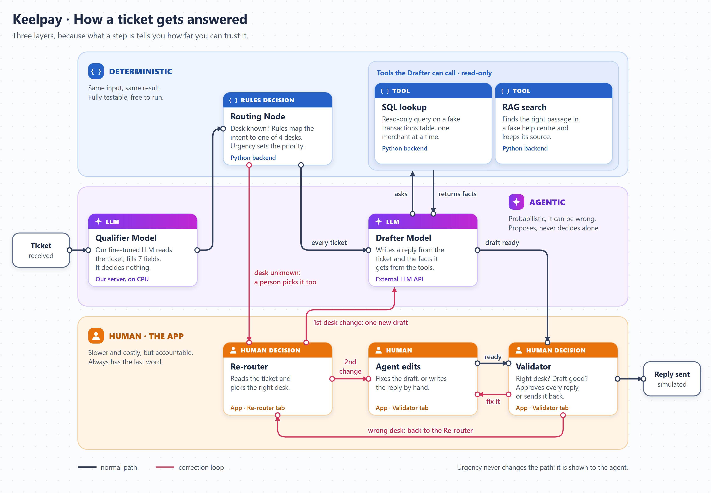

# agentic-workflow-subproject — Keelpay agentic workflow

**This is the sub-project of the course "Agentic Workflows & LLM Ops" (Albert School, M2).** The course asks for an end-to-end LLMOps flow on a text-generation use case of the team's own design: fine-tune a small open-source model with LoRA on Vertex AI, run it through a KFP pipeline, evaluate it, deploy it to an endpoint and put a small web app in front of it. The course is shared with "Data & AI Product: From Diagnosis to Delivery", whose project is the NAVY / Keelpay copilot described in the root `README.md`.

Our use case: the **Qualifier Model** turns a raw merchant ticket (French or English) into strict JSON, the first step of the copilot flow. The task, closed values and examples are in `initial_brief.md`. The code follows the course practice sessions and is adapted from the team's own working solution of those sessions (`Agentic-LLMOps`), changing the task from "translate to Yoda" to "read a ticket and return JSON". The deterministic Python **Routing Node** consumes this output; neither component is an agentic LLM.

It is an isolated uv project (own `pyproject.toml`, Python 3.11.6, `uv.lock`, `.venv`): the heavy ML dependencies stay out of the NAVY root environment.

## Target flow



This is the target flow; only the Qualifier Model exists today. A ticket is read by the Qualifier Model, the Routing Node picks a desk with Python rules, and the Drafter Model always writes a reply, calling read-only tools for facts (SQL lookup, RAG search; the first version drafts without them). A Support Agent corrects the desk in the Re-router when needed and approves every reply in the Validator. The first desk change triggers one new draft; after a second change, the agent fixes the draft or writes the reply by hand.

## Contract with the rest of NAVY

The Qualifier research and the future runtime belong to this sub-project. The runtime must preserve the JSON schema below at its inference boundary; the model endpoint and runtime are not yet deployed. The definitive shared-contract packaging remains to be selected before implementing the backend.

Keys: `intent`, `sub_intent`, `transaction_id`, `amount`, `currency`, `urgency`, `sentiment`. All values are strings: `"UNDEFINED"` when a field cannot be determined, `"OTHER"` when the request is understood but fits no listed class, `""` when `transaction_id`, `amount` or `currency` is absent. Contract in `ml/qualifier/src/dataset_build/schema.py`, definitions in `docs/label_definitions.md`. The future **Routing Node** lives in this subproject and blocks only the decision that depends on an unresolved field; an absent payment reference does not automatically block a known desk.

## Status (2026-11-03)

The plan, with its gates, is `docs/roadmap.md`; the day-by-day account is in `ml/qualifier/notebooks/`.

| Part | State |
|---|---|
| Dataset (`data/dataset/`: train 1922, val 293, test_natural 610, test_traps 380, plus quarantines) | done and frozen |
| Scoring (`ml/qualifier/src/scoring.py`) and baselines B0-B2 | done; B2 on test_natural: 33.9 silent errors per 100 tickets, 6.6 % of urgent tickets in a wrong desk (`docs/baseline_results.md`) |
| Pipelines on Vertex (training, base model, sweep) with Qwen2.5-3B-Instruct, float16 | training run done (2 h 06 of T4); B3 (prompted base model) scored on val, test_natural and test_traps, provenance in `data/runs/b3-2026-11-04-a_manifest.json`; sweep pipeline compiles but has not run |
| Model D (Qwen2.5-3B + LoRA) on val | 0.7 silent errors per 100 tickets against 28.3 for B2, 0 % of urgent tickets in a wrong desk against 7.6 % (`docs/results/`) |
| Compact variants (merged GGUF, smaller models) | D-q4 locked on val (0.3 silent errors per 100, 0 % urgent in a wrong desk, 6.4 s per ticket on CPU, about 20 euros a month); S-1.5B and S-0.5B cancelled (`docs/compact_variants.md`) |
| Final reading of the test sets (Gate G7) | done in `ml/qualifier/notebooks/05_final_evaluation.ipynb`. Champion D-q4: 0.7 silent errors per 100 tickets against 33.9 for B2, 0.6 % of urgent tickets in a wrong desk (1 of 167) against 6.6 %. Desk accuracy and auto-routing bars of the brief met; urgent guardrail and silent-error trigger not met on the model alone (`docs/scoring_protocol.md` section 8) |
| Qualifier Model registration in Vertex AI (Gate G8; historical registered name) | done: `keelpay-router-json` (ID 7308774847222382592, alias `qwen3b-lora-q4`, region europe-west2) |
| Shared NAVY demo scope (confirmed orally by Vincent) | To build: deployed Python API on Cloud Run with CPU Qualifier Model, deterministic Routing Node, synthetic lookup/KB, external synthetic-only Drafter Model, three-tab functional front end, Python Demo Injector, Langfuse traces; no real ticket data |

## Documents

| File | What it is |
|---|---|
| `docs/roadmap.md` | gates G1-G9 and the rules that stay fixed |
| `docs/scoring_protocol.md` | the metrics (silent errors first), the error severity score, the acceptance bars of the product brief, the selection rule, the systems, and the test results |
| `docs/methodology.md` | how we test, control cost and choose |
| `docs/label_definitions.md` | definition of each label |
| `docs/baseline_results.md` | B0-B2 on val and the test sets |
| `docs/compact_variants.md` | procedure and val results for merged GGUF models (D-q8, D-q4) and smaller models |
| `docs/results/` | predictions and loss history of full run D, D-q8, D-q4 and timings |
| `docs/mlops_tracking.md` | local MLflow setup, historical import, offline Vertex-manifest sync, Vertex registry linkage |
| `ml/qualifier/src/tracking.py` | shared MLflow run schema, metric normalization, provenance, idempotent records, and offline Vertex manifest sync |
| `ml/qualifier/scripts/import_legacy_results.py`, `sync_vertex_run.py`, `link_vertex_model.py` | local historical import, offline pipeline sync, and registry linkage |
| `ml/qualifier/notebooks/01_dataset_build.ipynb`, `02_scoring_and_baselines.ipynb`, `03_finetuning_vertex.ipynb`, `04_compact_variants.ipynb`, `05_final_evaluation.ipynb` | the experiment logbook (G1 to G8); B0-B3 and D variants compared on every split; open work in `docs/llmops_recovery_tasks.md` |
| `docs/data_science_masterclass.md` | metric choice, use-case error matrices, charts, model tagging, lineage, historical recovery, and experiment method |
| `specs/004-routing-node/error-consequences.md` | pending review of the deterministic routing tree and business consequences; gates product-level error metrics |
| `docs/llmops_recovery_tasks.md` | recovered unfinished LLM fine-tuning/MLflow work and completion checklist |

## Setup

```bash
cd agentic-workflow-subproject
uv lock --python 3.11
uv sync
cp .env.example .env   # fill in the values (never commit .env)
uv run python -m flow.setup_local   # creates .local/ and fetches the Qualifier model, about 2 GB
uv run python ml/qualifier/scripts/validate_gcp_setup.py
```

Start the local MLflow tracking server in a second terminal (localhost only; no cloud resources):

```bash
uv run mlflow server --backend-store-uri sqlite:///.local/mlflow/mlflow.db --default-artifact-root ./.local/mlflow/artifacts --host 127.0.0.1 --port 5000
```

The project dependency now includes MLflow. Regenerate `uv.lock` with `uv lock --python 3.11` before syncing dependencies.

The four splits of the dataset build (`data/dataset/{train,val,test_natural,test_traps}.csv`, committed for the exercise) are expected at `gs://<bucket>/dataset/`; each has a `ticket` column and a `target` column (the expected JSON as a string).

```bash
uv run python ml/qualifier/scripts/upload_dataset.py
uv run python ml/qualifier/scripts/pipeline_runner.py training --fp16 --smoke --confirm-billable-run           # calibration: 200 tickets, 40 steps, 20 predictions
uv run python ml/qualifier/scripts/pipeline_runner.py training --fp16 --confirm-billable-run                   # full run, predicts on val (about 2 h 06 of T4 for the 3B model)
uv run python ml/qualifier/scripts/pipeline_runner.py base --confirm-billable-run                               # the base model alone (system B3)
uv run python ml/qualifier/scripts/pipeline_runner.py training --fp16 --model-id Qwen/Qwen2.5-1.5B-Instruct --confirm-billable-run   # smaller model
uv run python ml/qualifier/scripts/pipeline_runner.py sweep --confirm-billable-run                              # 7 chained trainings: only after a single run was checked

# then, locally: download the predictions CSV of the inference step and score it
uv run --with scikit-learn python ml/qualifier/scripts/score_predictions.py <predictions.csv> val
uv run python ml/qualifier/scripts/import_legacy_results.py --dry-run
uv run python ml/qualifier/scripts/import_legacy_results.py --include-b3   # local B3 export only; validates the split and logs to local MLflow
```

The B3 import does not access Vertex or GCS. Inspect Vertex Pipelines/ML Metadata and its output artifacts first. If a required B3 inference output is genuinely absent, the project lead has authorized a targeted, versioned inference rerun for the missing split(s); this is not retraining. Capture cost, exact provenance, and teardown checks.

## Run the ticket flow locally

`flow/` takes a validation ticket through the Qualifier Model, the Routing Node and the Drafter Model, and stops at the first human step. Spec: [`specs/012-flow-script`](specs/012-flow-script/spec.md).

Needs the setup above, Docker, `OPENROUTER_API_KEY` and the Langfuse keys in `.env`. The Qualifier needs about 2 GB of free Docker memory: when it runs out, the container stops and tickets go to the Re-router with status `unavailable`. Without Langfuse keys, the flow still runs.

```bash
docker compose -f flow/docker-compose.yml up -d    # about 40 s to load the model
uv run python -m flow.runner --n 5 --seed 7 --every 30
docker compose -f flow/docker-compose.yml down
```

Each run writes to `.local/runs/<run_id>.jsonl`. It sends nothing, and it reads the validation split only.

## Training settings

Starting point of the course (3 epochs, LoRA r=8 alpha=16 dropout 0.05, learning rate 3e-4, 4-bit base model), with three changes for our data: sequences of 1024 tokens (our chats have a median of 495 and a p99 of 813, so 512 cut the JSON answer off 41 % of the tickets), no packing, and a loss on the assistant answer only. The best checkpoint on validation loss is kept; `log_history.json` in the model artifact holds the loss curve. Run the `--smoke` pipeline first (time and memory per step, loss going down, valid JSON), then one full run, then read the curve before any sweep.

## Cost and teardown: be vigilant

Vertex AI is billed to the school's credits. Two very different cases:

- **Pipeline jobs (training, sweep, base model, inference)** are ephemeral: the GPU machine exists for the task and is released when it ends, whether it succeeds or fails. Still, after every run, check in the Vertex AI console (Pipelines, then Training jobs) that nothing stays `RUNNING` or `PENDING`, and stop a task that looks stuck. The sweep chains 7 trainings: do not start it before a single run has been checked.
- **An endpoint is never ephemeral.** It bills per node and per hour, there is **no scale to zero**, and it keeps billing while idle. As soon as the tests are done: undeploy the model, then delete the endpoint (console, Online prediction, Endpoints), and check that the list is empty. Keep `min_replica_count=1` and `max_replica_count=1`. Never leave an endpoint over a night or a weekend.

Before any billed command: say whether it is local (free) or on GCP (billed) and what will stop it.

## Layout

`ml/` builds and evaluates the models, `flow/` uses them and `frontend/` shows them. The rules are in [`LAYOUT.md`](LAYOUT.md), and `tests/test_layout.py` enforces them.

The flow runs locally, and the Qualifier work is complete. The front end has the Overview page on sample numbers (`cd frontend && npm install && npm run dev`; `npm run check` verifies that the numbers reconcile). The API does not exist yet.

```
flow/                      # ticket flow: Qualifier call, Routing Node, Drafter, runner
frontend/                  # Overview on sample data; planned Re-router and Validator
ml/qualifier/
  src/
    constants.py           # settings from environment variables
    prompt.py              # the instruction shared by training, inference and serving
    tracking.py            # shared MLflow metadata, metrics, artifact and lineage contract
    dataset_build/         # synthetic dataset: JSON output contract (schema.py), cards, generation, review, export
    scoring.py, baselines.py # metrics and baselines B0-B2 of docs/scoring_protocol.md
    handler.py             # Vertex AI EndpointHandler
    pipeline_components/   # KFP components
    pipelines/             # training and sweep pipelines
  scripts/                 # GCP, baselines, scoring and MLflow entry points
  notebooks/               # the five Qualifier journals and their helpers
data/dataset/              # frozen synthetic dataset; see .gitignore for other artifacts
.local/                    # untracked: models, MLflow, logs, compiled pipelines, runs, figures
docs/                      # protocol, roadmap, methodology, results (see the table above)
tests/                     # same folders as the code: flow/, qualifier/
```
