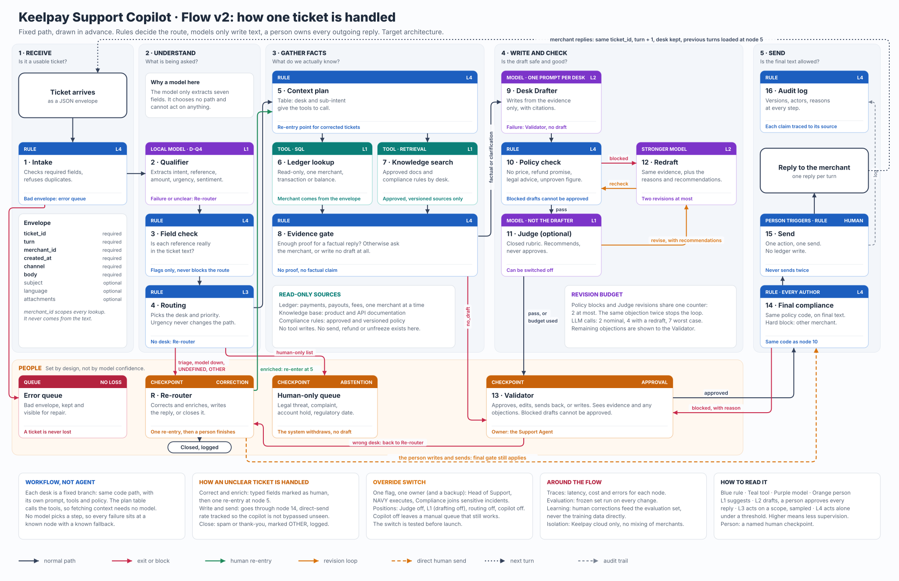

# Target Architecture: Keelpay Demo

**Status: target validated 6 November 2026; implementation partial, updated 10 November 2026.** The flow, nodes and measures are in [flow-v2/node_table_v1.md](flow-v2/node_table_v1.md); the current diagram is [flow_v2.svg](flow-v2/flow_v2.svg); the build order is in [specs/013-flow-v2/tasks.md](../../specs/013-flow-v2/tasks.md). Names: [terminology](terminology.md). Screens: [workflow and UX](copilot-workflow.md). This page keeps what the node table does not cover: runtime, state, failures and deployment.

## Runtime pieces

| Piece | Role | Status |
|---|---|---|
| Demo Injector | Sends synthetic tickets (the envelope with `ticket_id` and `turn`) at a controllable cadence | Implemented; single-ticket ingress/idempotency smoke only, broader replay remains |
| Python API and backend | Ingress, state, orchestration of the fixed path, UI commands; auth, validation, idempotency, secrets server-side | Local prototype implemented; restart and full-flow acceptance remain |
| Durable store | Tickets, queues, versions, events; the authority for counters and history | SQLite prototype; durability acceptance remains |
| Qualifier Model (node 2) | D-q4, local CPU | Trained and measured; local serving prototype, availability/acceptance remains |
| Front end | Overview, Re-router, Validator; no business rules of its own | Local API-backed prototype; UX and full-flow acceptance remain |
| Langfuse | Derived traces; it never decides ticket status | Prompt management integration exists; complete correlated runtime tracing remains |

The workflow path is fixed and orchestrated with LangGraph. LangChain provides model integrations and structured-output support where used; it does not own business state or routing. Tools (nodes 6 and 7) have typed contracts, merchant scope, timeout and trace. Node 6 is SQL; node 7 is deterministic lexical Text Search. Both are read-only and separately reported; when both are planned, they execute concurrently and the Evidence Gate waits for both.

**Design decision update (10 November 2026):** [ADR 0001](adr/0001-text-search-and-ticket-resolution.md) supersedes the RAG terminology and defines the send-time ticket disposition. The two evidence tools are SQL and deterministic Text Search; neither is agentically selected, and embeddings are not a V1 requirement. At send, the Support Agent explicitly chooses to leave the ticket open or close it. Manual closure without a reply remains a distinct action. The SVG above is intentionally unchanged and does not yet depict these decisions.

## Authoritative state and events

Ticket state and transitions are the source for counters, history, queues, and Overview. Langfuse receives derived traces and may lag; it does not decide eligibility, ordering, or ticket status. Each command changes state through the backend and records actor, server timestamp, version, required reason, and outcome. Ingress and send are idempotent.

Minimum readable states distinguish `received`, `qualifying`, `reroute_required`, `gathering_evidence`, `drafting`, `review_ready`, `no_draft`, `manual_required`, `send_blocked`, `sent_open`, `sent_closed`, `closed_manual`, `failed_retryable`, and `failed_manual`. Runtime enum names may differ, but sent-open, sent-closed, and manually closed without a reply remain distinguishable; an error is never conflated with a missing ticket or human wait.

Minimum events: ingress with `turn`; each node start, finish and error; Routing decision and version; evidence decision (`factual`, `clarification`, `no_draft`); SQL and Text Search outcomes as separate events; draft version and edit; policy result; Judge recommendation; human correction, send disposition (`leave_open` or `close`) or close-without-reply with reason; agent claim and release; final compliance result; simulated send.

## Queues and experience

Two operational queues: **Re-router** for desk corrections and **Validator** for generated drafts. Default order is oldest received first; show total age and current-step age. An explicit urgent-first mode sorts by priority and then FIFO within each level. New arrivals do not replace the selected task. Overview counters use defined transitions and a stated period/denominator. Simulated demo sessions are separate from genuinely connected Support Agents.

Clicking the Re-router node opens its oldest eligible task under the active ordering mode; clicking the Validator node does the same in the Validator queue. Claim is atomic. If no task is available or it is claimed, state that clearly.

## Failures and recovery

- Qualifier Model failure or invalid output: Re-router, with a reason code.
- SQL or Text Search `unavailable`, `missing` or `ambiguous`: the Evidence gate returns `clarification` or `no_draft`; no unsupported factual reply. If both are selected, both results are awaited independently.
- Drafter Model timeout or error: Validator with the context and no draft; a person writes.
- Langfuse outage: expose an observability incident; ticket state continues according to runtime policy, without claiming a trace exists.
- Human correction at the Re-router or Validator: one re-entry at node 5; a second correction means the person finishes.

## Deployment boundary

Dockerized Python API/orchestration on Cloud Run, compact CPU Qualifier Model, persistent store external to the instance, static front end on GitHub Pages or Cloudflare Pages (choose in the technical plan), and external Drafter Model/Langfuse only for synthetic demo data. Provider secrets stay server-side. Demo costs must be separate from production sizing. Do not describe a URL or configuration as deployed until deployment is actually verified.
