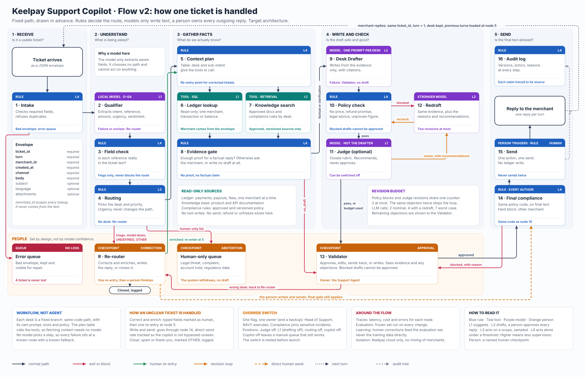

# Target Architecture: Keelpay Demo

**Status: target validated on 6 November 2026, not implemented.** The flow, the nodes and their measures are in [flow-v2/node_table_v1.md](flow-v2/node_table_v1.md); the diagram is [flow_v2.svg](flow-v2/flow_v2.svg); the build order is in [specs/013-flow-v2/tasks.md](../../specs/013-flow-v2/tasks.md). Names: [terminology](terminology.md). Screens: [workflow and UX](copilot-workflow.md). This page keeps what the node table does not cover: runtime, state, failures and deployment.

## Runtime pieces

| Piece | Role | Status |
|---|---|---|
| Demo Injector | Sends synthetic tickets (the envelope with `ticket_id` and `turn`) at a controllable cadence | To build |
| Python API and backend | Ingress, state, orchestration of the fixed path, UI commands; auth, validation, idempotency, secrets server-side | To build |
| Durable store | Tickets, queues, versions, events; the authority for counters and history | Technology to choose |
| Qualifier Model (node 2) | D-q4, local CPU | Trained and measured; serving to build |
| Front end | Overview, Re-router, Validator; no business rules of its own | To build |
| Langfuse | Derived traces; it never decides ticket status | To integrate |

The path is a fixed workflow written in plain Python. LangGraph or LangChain may compose it only if the implementation plan shows a gain; neither is selected. Tools (nodes 6 and 7) follow the tiers of the node table, with typed contracts, merchant scope, timeout and trace.

## Authoritative state and events

Ticket state and transitions are the source for counters, history, queues, and Overview. Langfuse receives derived traces and may lag; it does not decide eligibility, ordering, or ticket status. Each command changes state through the backend and records actor, server timestamp, version, required reason, and outcome. Ingress and send are idempotent.

Minimum readable states distinguish `received`, `qualifying`, `reroute_required`, `gathering_evidence`, `drafting`, `review_ready`, `no_draft`, `manual_required`, `send_blocked`, `sent_simulated`, `failed_retryable`, `failed_manual`, `closed`. The runtime plan may normalize enum names, but must not conflate an error with a missing ticket or human wait.

Minimum events: ingress with `turn`; each node start, finish and error; Routing decision and version; evidence decision (`factual`, `clarification`, `no_draft`); draft version and edit; policy result; Judge recommendation; human correction, direct send or closure with reason; agent claim and release; final compliance result; simulated send.

## Queues and experience

Two operational queues: **Re-router** for desk corrections and **Validator** for generated drafts. Default order is oldest received first; show total age and current-step age. An explicit urgent-first mode sorts by priority and then FIFO within each level. New arrivals do not replace the selected task. Overview counters use defined transitions and a stated period/denominator. Simulated demo sessions are separate from genuinely connected Support Agents.

Clicking the Re-router node opens its oldest eligible task under the active ordering mode; clicking the Validator node does the same in the Validator queue. Claim is atomic. If no task is available or it is claimed, state that clearly.

## Failures and recovery

- Qualifier Model failure or invalid output: Re-router, with a reason code.
- Tool `unavailable`, `missing` or `ambiguous`: the Evidence gate returns `clarification` or `no_draft`; no unsupported factual reply.
- Drafter Model timeout or error: Validator with the context and no draft; a person writes.
- Langfuse outage: expose an observability incident; ticket state continues according to runtime policy, without claiming a trace exists.
- Human correction at the Re-router or Validator: one re-entry at node 5; a second correction means the person finishes.

## Deployment boundary

Dockerized Python API/orchestration on Cloud Run, compact CPU Qualifier Model, persistent store external to the instance, static front end on GitHub Pages or Cloudflare Pages (choose in the technical plan), and external Drafter Model/Langfuse only for synthetic demo data. Provider secrets stay server-side. Demo costs must be separate from production sizing. Do not describe a URL or configuration as deployed until deployment is actually verified.
