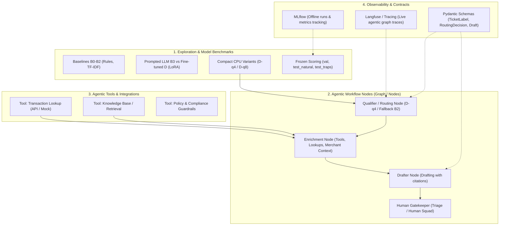

# Target Architecture Memo — `agentic-workflow-subproject/`

> **Context:** This document formalizes the evolution vision of this subproject following the renaming of `finetuned_llm_classifier/` to `agentic-workflow-subproject/`. The objective is to define clear boundaries between exploratory components, models, agentic tools, and workflow nodes (routing and draft synthesis).

---

## 1. Motivation for the Renaming

Originally, this folder only housed scripts and notebooks dedicated to ticket qualification and fine-tuning a small language model (Qwen2.5-3B + LoRA).

In the target architecture of the Keelpay Copilot support system, the full service goes well beyond a simple isolated classifier:
- **A multi-node workflow graph** (Routing Node -> Enrichment Node -> Drafter Node -> Human Review).
- **Agentic tools** to retrieve merchant context, query internal knowledge bases, and simulate transaction lookups.
- **A hybrid observability layer** (MLflow for offline model benchmarking, Langfuse for real-time agentic execution traces).

---

## 2. Architectural Pillars & Separation of Concerns

To keep code structure maintainable, testable, and evolutive, the target organization is separated into 4 distinct layers:

---

## 3. Target Module Details

### Layer 1: Models & Benchmarks (`src/models/` or historical)
- **Role:** Training, GGUF quantization, unified evaluation.
- **Data integrity principle:** Test splits (`test_natural.csv`, `test_traps.csv`) remain sealed and are evaluated strictly once.
- **MLflow Circuit-Breaker:** No script or notebook should hard-fail or freeze when MLflow is offline. Fast automatic fallback to local artifacts in < 0.1s.

### Layer 2: Decision Nodes (`src/nodes/`)
- **`RoutingNode`:** Executes inference of the champion model (D-q4 CPU). If confidence is below threshold or JSON is malformed -> route to Human Triage automatically.
- **`EnrichmentNode`:** If `transaction_id` is present, verify statuses and fetch operational metadata without exposing critical PII.
- **`DrafterNode`:** Synthesizes draft responses citing verified sources of truth, eliminating hallucinated amounts or dates.

### Layer 3: Tools (`src/tools/`)
- Pure functions or asynchronous clients equipped with strict timeouts.
- Fully mockable tools for offline unit and integration testing.

### Layer 4: Deployment & Demo (`src/app/`)
- FastAPI / Cloud Run backend API.
- Three-panel Copilot UI (Ticket / Routing recommendation / Editable draft with cited sources).

---

## 4. Next Steps (Future Backlog)
- [ ] Group model exploration scripts into a clear subfolder (`benchmarks/` or `experiments/`).
- [ ] Isolate LangGraph workflow definitions within a dedicated `workflow/` package.
- [ ] Centralize environment and logging configuration in a unified config module.
