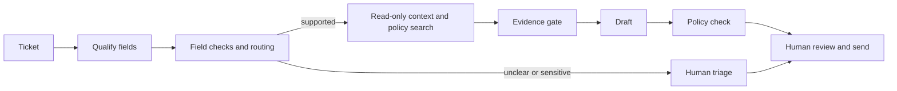

# Keelpay Support Copilot — AI Product pitch V1

Draft for an eight-minute oral · Team NAVY · English presentation

**Status:** working draft. Scenario inputs, estimates, measured results and proposals are labelled throughout. The demo needs to be recorded and the experiment and launch decisions completed before presenting as commitments.

**Progress gauge on every slide:** Need → Value → Product → Evidence → Measure → Operate → Decision. Highlight the current chapter; show a short filled progress bar on the cover and the chapter names thereafter.

## 1 · Cover — 5 s

**Keelpay Support Copilot**  
Helping support agents resolve merchant tickets with human control

Team NAVY · Data & AI Product

*Visual:* product interface or a simple ticket-to-agent illustration. Gauge starts at Need.

## 2 · Our route — 10 s

Need · Value · Product · Evidence · Measure · Operate · Decision

*Visual:* the same seven chapters used in the gauge. Introduce the team briefly; all four members speak during the pitch.

## 3 · A support process under pressure — 30 s

**36,000 tickets a month · 2,500 merchants · one in seven tickets reaches the wrong desk first.**

Agents read and route free-text requests, search for the payment, then write and verify the reply. An urgent dispute can lose time in a second queue.

*Visual:* one representative merchant request and a four-step current journey: read → route → find payment → reply. Mark the handover after a wrong route.

*Say:* Keelpay is a fictional B2B payments company; volumes and the misrouting rate are scenario inputs. [01 problem statement](../01_problem_statement.md).

## 4 · Where the work goes — 25 s

**60% of handling time occurs before final review and sending.**

15% reading and routing · 45% finding the payment and drafting · 40% validation, sending and other work.

*Visual:* a single 100% horizontal bar. Mark the disconnected helpdesk and ledger and the ambiguity of free text as causes. The 10-minute ticket baseline is a sizing assumption, not an observed time study.

## 5 · The economic decision — 35 s

**The expected annualised net value is €214k, subject to unverified assumptions.**

| Year-one annualised net value | Low | Base | High | Weighted expected value |
|---|---:|---:|---:|---:|
| Copilot | −€78k | €194k | €703k | €214k |
| Rules-only alternative | €12k | €100k | €236k | €101k |
| Do nothing | €52k | €93k | €181k | €98k |

*Visual:* three scenario points and comparison lines; explain that value includes capacity, handovers, processing, supervision, fixed costs and assumed errors. Values are model outputs; probabilities are judgments. Source: [investment memo](../02_investment_memo.md) and `02_sizing.xlsx`.

## 6 · The assumption that decides the investment — 25 s

**Under base assumptions, the copilot must save 13.32% of active time to beat the rules-only alternative.**

The base case assumes 20.26% saved. Neither the full-flow saving nor post-review serious-error rate has been measured.

*Visual:* line from 0 to 20%, with the 13.32% hurdle and 20.26% assumption labelled. The low scenario loses money. The threshold changes with the assumptions.

## 7 · A copilot for support agents — 25 s

**Read, route, find context and propose a reply; the agent remains responsible for sending.**

The first version assists four desks. Ambiguous cases go to a person. Autonomous sending, refunds and ledger writes are outside scope.

*Visual:* an agent workspace with ticket, transaction candidates and draft. Source: [product brief](../03_product_brief.md).

## 8 · User research changed the design — 20 s

**Make waiting time and the selected transaction visible.**

Two classmates playing support roles completed the prototype task; their feedback led to visible queue age and clearer transaction selection. Three role-play interviews informed the design; these are not interviews with real Keelpay agents.

*Visual:* two small before/after crops or annotations. [User research](../03_user_research.md).

## 9 · The full workflow — 35 s

**Models read and draft; rules check and route; a person reviews and sends.**

*Visual:* redraw the complete workflow from `agentic-workflow-subproject/docs/design/flow-v2/flow_v2.svg`; mark human checkpoints and the proposed switch clearly. Show implemented versus designed controls after checking their status. No claim of a tested switch without evidence.

## 10 · Demo: one ordinary case, one refusal — 60 s

1. A payment request: inspect extracted information, choose the transaction, review sources and draft, then simulate sending.
2. An ambiguous or sensitive request: show the handover to a person and why a draft is withheld.

*Visual:* live demo or recorded video. Confirm the second case works on the version shown; if not, label it as a target behaviour. Keep a video backup. The demo uses synthetic data.

## 11 · Prototype evidence and open gates — 35 s

**Routing showed promise; the earlier draft workflow failed its safety gate.**

| 13 November evaluation | Result | Gate or context |
|---|---:|---|
| Automatically routed | 37 / 50 = 74% | ≥50% |
| Misrouted among auto-routed | 1 / 37 = 2.7% | Scenario baseline 14.3%; small sample |
| Urgent misroutes | 0 / 8 | Target zero; insufficient to establish rare risk |
| Drafts on human-only cases | 4 / 4 | Target zero: failed |
| Drafts both graders would send unchanged | 2 / 30 | Earlier ungrounded workflow |

*Say:* These are historical results, not a measurement of the current flow. Rerun after fixes before claiming the gate is closed. [Evaluation report](../evals/report_v0.md).

## 12 · Measure success at five levels — 30 s

**A faster ticket is only a success if quality and safety hold.**

Model validity → workflow routing and draft quality → safety checks → handling time and QA → economic value.

*Visual:* five-level ladder with one example each. The 30-case grading exercise found 80% agreement between humans; the judge agreed on 23 of the 24 cases where both humans agreed. The rubric was clarified afterwards; the rates were not remeasured. [Metrics](../05_metrics.md).

## 13 · The business promises — 25 s

| Outcome | Starting point | Desired effect |
|---|---|---|
| Active agent cost per ticket | €7, about 10 minutes — assumptions | Lower; full-flow saving must beat the economic hurdle |
| Misrouting and handovers | About 1 in 7; €3 per handover — scenario and assumption | Reduce; €36.5k avoided in the year-one base sizing |
| Serious errors reaching merchants | Assumed rates by category | No increase; validate against control |

*Visual:* three baseline-to-target rows. These are hypotheses, not measured business outcomes.

## 14 · Guardrails and counter-metrics — 30 s

**Primary:** active handling time per ticket, copilot on versus off.

**Guardrails:** no urgent auto-route to the wrong desk; serious errors no worse than the agreed baseline; QA no lower than control.

**Counter-metrics:** repeat contact within seven days; wrong-payment drafts approved unread. Read by language, desk, urgency, difficulty and agent seniority.

*Visual:* primary metric at centre, three safety checks and two counter-metrics around it. Baselines and rare-error detection need validation.

## 15 · Prove the effect — 30 s

**Compare handling time with and without the copilot, at constant quality.**

Proposed design: alternate copilot-on and copilot-off weeks for the same agents; record active time, QA and repeat contacts. Pre-register segments, thresholds and the ship / iterate / stop rule before the first ticket.

*Visual:* two parallel tracks and a decision gate. Sample size, duration, slowest guardrail and treatment carryover remain to be resolved in the S6–7 deliverable. A 13.32% saving is the base economic hurdle, not proof of statistical significance.

## 16 · Monitor, intervene, learn — 30 s

Infrastructure · model quality · product and guardrails · business: each needs a threshold, cadence and accountable owner.

If repeat contacts worsen for a language or desk for two consecutive weeks, or rerouter corrections exceed the current misroute baseline, the governance plan calls for drafting to drop to context-only for that segment. Support owns the decision, with Compliance for sensitive desks.

*Visual:* four monitoring layers and an incident-to-human fallback. The switch implementation, day/night backup, execution time and last rollback test require confirmation; do not claim they have been tested. [Governance](../governance.md).

## 17 · Decision and request — 30 s

**Go to build and evaluate the synthetic demo. Conditional go for a pilot only after the gates are met.**

Next: re-evaluate the current full flow; validate quality, time saved and residual risk; agree the experiment, owners and rollback with Support and Compliance. No production rollout is approved.

*Visual:* gate track: synthetic demo → controlled evaluation → conditional pilot → decision. Annualised fixed/semi-fixed base costs are €74.3k in the sizing; a pilot budget and signatories need confirmation before being presented as an approved request.

## 18 · Closing — 10 s

**Ask:** support a controlled evaluation of the copilot and decide on a pilot only when its value and safeguards are demonstrated.

*Return to the opening ticket:* the goal is to help the agent reach the right answer sooner, with the right transaction and a human in control.

---

## Preparation and unresolved items

- Target speaking time: approximately 7 minutes 10 seconds, including a one-minute demo; rehearse and adjust with the team.
- Assign speakers and record the demo; check the refused case on the actual version used.
- Complete `06_07_experiments_operations.md` and `08_launch_memo.md`, including the sample, decision rules, named owners, budget and rollback test. Avoid presenting proposals as completed actions.
- Check current implementation and rerun the full-flow evaluation before replacing the historical results. The full workflow diagram should distinguish built controls from planned ones.
- Prepare three business metrics with agreed baselines and targets; distinguish a safety non-effect from a business improvement when explaining the third metric.
- The course instructions say slides and demo video are brought on laptops and do not go on Git; this draft is a working file, not the final hand-in.
