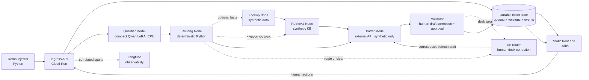

# Target Architecture — Keelpay Demo

**Status: proposed, not implemented.** Canonical component names: [NAVY Reference Terminology](terminology.md). Target behavior: [Product Specification](../../spec.md) and [Workflow / UX](copilot-workflow.md).

## Flow

## Responsibilities and trust boundaries

| Component | Input / output | Source of truth / control | Status |
|---|---|---|---|
| Demo Injector | Synthetic set + cadence → idempotent request | Demo identity/cadence; no production authentication implied | To build |
| Python API/backend | Ingress, state reads/writes, orchestration, UI commands | Auth, validation, idempotency, atomic transitions; secrets server-side | To build |
| Qualifier Model | Text → strict seven-field contract | D-q4 candidate; backend parsing/validation; historical benchmark only | Model trained/measured; Cloud Run CPU serving to build |
| Routing Node | Ticket + intent/sub-intent/urgency → initial desk and visible priority | Deterministic, versioned Python mapping; draft continues if routing may need correction | To specify in Feature 004 |
| Lookup Node | Merchant + payment keys → candidates/result | Synthetic ledger fixture, `merchant_id` filter, no write path | To build |
| Retrieval Node | Intent/context → excerpts and source IDs | Versioned synthetic KB and approved-source list | To build |
| Drafter Model | Ticket + available context → draft attempt | Draft even when the desk may need correction; Validator handles quality issues after generation | To integrate |
| Event store / queues | Commands and transitions → current state + history | Durable backend authority, versions, claims/locks, idempotency | Technology to choose |
| Front end | Backend state → Overview, Qualification & Routing, Replies to Review | No duplicated business rules; no service secrets | To build |
| Langfuse | Allowed technical/action spans → traces | Ticket/step/version correlation; delay/outage does not alter queue authority | To integrate |
| Re-router | Proposed desk + ticket → corrected desk | One human workflow node; correction invalidates prior draft and triggers a fresh draft | Target workflow |
| Validator | Generated draft + ticket/context → corrected/approved draft | One human workflow node; can hand desk errors to Re-router and approve simulated send | Target workflow |
| Support Agent | Human role acting in Re-router and Validator | Actions recorded against versions; no auto-send | Target workflow |

## Workflow orchestration and Drafter tools

The runtime may use **LangGraph or LangChain** to compose and observe the end-to-end flow; evaluate the fit in the implementation plan rather than treating either library as selected. The orchestrator coordinates backend nodes and state transitions. It does not replace the deterministic Python `Routing Node`, move queue authority out of the backend, or grant the `Drafter Model` policy authority.

The `Drafter Model` tool set should be extensible through an explicit allowlist. Each tool needs a typed input/output contract, tenant and data scope, authorization, timeout/error behavior, and trace correlation. Tools may retrieve or inspect approved synthetic context; they cannot send messages, change queues or routing decisions, write to a ledger, issue refunds, or unfreeze accounts. The backend and `Routing Node` decide which operations are available for a ticket.

## Authoritative state and events

Ticket state and transitions are the source for counters, history, queues, and Overview. Langfuse receives derived traces and may lag; it does not decide eligibility, ordering, or ticket status. Each command changes state through the backend and records actor, server timestamp, version, required reason, and outcome. Ingress and send are idempotent.

Minimum readable states distinguish `received`, `qualifying`, `qualification_required`, `looking_up`, `drafting`, `review_ready`, `manual_required`, `send_blocked`, `sent_simulated`, `failed_retryable`, and `failed_manual`. The runtime plan may normalize enum names, but must not conflate an error with a missing ticket or human wait.

Minimum events: ingress; Qualifier Model start/finish/error; Routing Node decision/version; qualification requested/resolved; Lookup Node start/result; payment selection; Retrieval Node result; Drafter Model start/finish/error; draft version/edit; agent claim/release; requalification/desk change; send check; simulated send.

## Queues and experience

Two operational queues: **Qualification & Routing** for blocking decisions and **Replies to Review** for stable drafts. Default order is oldest received first; show total age and current-step age. An explicit urgent-first mode sorts by priority and then FIFO within each level. New arrivals do not replace the selected task. Overview counters use defined transitions and a stated period/denominator. Simulated demo sessions are separate from genuinely connected Support Agents.

Clicking a Human Qualification node opens its oldest eligible task under the active ordering mode; clicking Human Review does the same in the review queue. Claim is atomic. If no task is available or it is claimed, state that clearly.

## Failures and recovery

- Qualifier Model failure: record the error and send to qualification/manual recovery; evaluate any independent signals available.
- Lookup failure: make no payment assertion; offer clarification or manual recovery.
- Retrieval failure or insufficient sources: do not produce an unsupported factual reply.
- Drafter Model timeout/error: keep the ticket and context; offer controlled retry or manual writing.
- Langfuse outage: expose an observability incident; ticket state continues according to runtime policy, without claiming a trace exists.
- Draft invalidated by desk/context change: retain its version, block sending, and recalculate once; a second desk change goes to manual triage.

## Deployment boundary

Dockerized Python API/orchestration on Cloud Run, compact CPU Qualifier Model, persistent store external to the instance, static front end on GitHub Pages or Cloudflare Pages (choose in the technical plan), and external Drafter Model/Langfuse only for synthetic demo data. Provider secrets stay server-side. Demo costs must be separate from production sizing. Do not describe a URL or configuration as deployed until deployment is actually verified.
