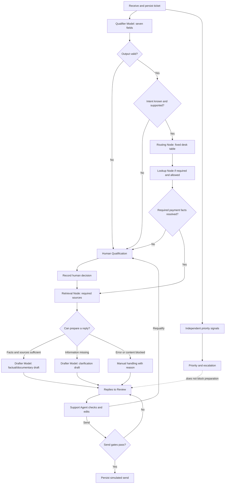

# Keelpay Workflow and Demo Experience

Status: agreed target behavior, 3 November 2026. Read with [Product Specification](../../spec.md) and [NAVY Reference Terminology](terminology.md). The original V0 mock-up illustrates a sample interface; it does not implement this flow.

## 1. Demo outcome

The audience watches synthetic tickets arrive, follows their processing, then takes the role of a Support Agent to qualify, correct, reroute, edit, and send a simulated reply. Ticket content and merchant sends are fictitious; ingestion, calculations, queues, actions, and history work against real persistent backend state.

The front end has three distinct tabs: **Overview**, **Qualification & Routing**, and **Replies to Review**. The two workspaces share the same tickets; Overview explains the process using their actual backend events.

The **Qualifier Model** returns seven fields and never selects a queue or invokes an action. The **Routing Node** is a deterministic Python node that decides desk, priority, dependencies, and preparation mode. The **Lookup Node** and **Retrieval Node** are deterministic Python nodes; the **Drafter Model** proposes a reply. Only a human Support Agent qualifies when needed and approves each send.

These decisions are independent. Missing or ambiguous information blocks only the dependent step. Unknown sentiment does not block routing. An unidentified payment does not necessarily make the desk unknown. High priority does not prevent draft preparation. Every reply is reviewed before its simulated send.

## 2. Qualification & Routing

**Purpose:** resolve cases that prevent appropriate reply preparation. Automatically handled tickets should not require a routine first human click.

**Queue:** requester, subject, wait age, suggested desk or “To determine,” priority, and a concrete reason (multiple requests, payment needs identification, conflicting reference, qualification unavailable). Keep filters limited to priority, reason, and desk. Distinguish actionable tickets from in-progress work.

**Dossier:** original message, relevant passages, system suggestion and business reason, known/missing information, and the consequence of each decision. Full JSON may be collapsed. Do not display invented confidence scores.

**Actions:** choose/correct desk and sub-intent; confirm a payment among verified candidates; request clarification; or handle manually. A duplicate-payment request may retain multiple relevant IDs in the ticket context without changing the model's seven-field contract.

Primary action: **Confirm qualification**. It saves corrections, reruns dependent steps, and advances to preparation/final review. It never sends. Secondary action: **Handle manually**, with a reason. Unsupported intents can remain in triage; do not invent a specialist desk.

For payment ambiguity, a clarification is a valid outcome. The Support Agent is never forced to pick a candidate arbitrarily just to advance the ticket.

## 3. Replies to Review

**Purpose:** understand the case, verify facts and sources, optionally edit, and send a simulated reply.

**Queue:** stable drafts ready for review, showing desk, requester, subject, age, and relevant badges. Show in-progress preparation separately. Blocking qualifications remain in the first workspace.

**Dossier:** merchant message, factual summary, selected payments, sources, editable draft, and concrete attention items such as “Funds on hold — do not promise a date,” “Reference missing — clarification reply,” “Desk changed,” or “Documentary reply — payment not required.” Explain the reason and required action; color alone is insufficient.

**History:** receipt, qualification, rules applied, lookups, results, human corrections, reroutes, draft versions, errors, and simulated send. Merchant history is separate and restricted to that merchant. Keep details accessible without hiding the writing area.

Primary action: **Send and next**. Secondary: **Requalify**, opening the same ticket in Qualification & Routing; manual writing and details are secondary actions. Edit inline. Avoid a toolbar of technical actions.

### Send gates

| Situation | Behavior |
|---|---|
| Empty draft, active processing without stable version, already sent, or stale version | Block with a specific reason |
| Required qualification/facts unresolved for a factual reply | Block that factual reply; allow compliant clarification or manual reply |
| Blocking content guardrail | Show passage/reason; require correction and recheck, no blind override |
| Draft unchanged | Targeted confirmation: “You have not edited this draft. Confirm you checked the facts and sources before sending it as written.” Do not require cosmetic edits |
| Critical attention item unacknowledged | Require explicit acknowledgement; editing does not acknowledge it |
| Draft edited | Validate the current version; editing alone does not prove quality |
| All checks pass | Save version, Support Agent, and one idempotent simulated-send event |

Group relevant confirmations into one send panel. If a correction is needed, return the Support Agent to the relevant field. “Send and next” never bypasses unresolved issues.

## 4. Live Overview

**Purpose:** explain how the demo actually works, its bottlenecks, and trade-offs without requiring the audience to read traces.

Main flow: Demo Injector → Qualifier Model → Routing Node → Lookup Node / Retrieval Node → Drafter Model → Human Review → Sent. Show branches to Human Qualification, rerouting and re-preparation, clarification, and errors. Queues are waiting tickets; processing counts are tickets actually in progress.

| Metric | Definition and display |
|---|---|
| Flow activity | Animate a backend transition; show waiting and in-progress counts by step |
| Tickets | Received, active, sent, failed; received is not the same as processed |
| Human presence | Recent sessions; distinguish connected, available, and busy only when implemented |
| Initial automatic assignment | Tickets automatically assigned a desk / tickets with an initial assignment decision; show period and denominator |
| Human qualification | Tickets requiring qualification / tickets with an initial decision; also show current queue backlog |
| Rerouting | Tickets whose desk changed after initial assignment / tickets initially assigned; show total changes separately |
| Urgency | Open priority tickets, unclaimed, overdue; age of oldest |
| Preparation | Drafts in progress, ready, or failed; show step latency and queue wait separately |
| Human review | Replies sent, edited, or sent unchanged; edit rate is not a quality measure |
| Incidents | Failed step, affected tickets, and recovery path; never hide the ticket |

Nodes and counters can open the relevant tickets, then their dossier. Animated events may be batched, but counts must remain exact. Do not show accuracy or “correct routing” without reference labels or review; a low reroute rate is not proof of correctness.

All tabs and queues use the same backend state. Langfuse observes technical spans and versions; it does not manage queues. UI values must not be reconstructed from potentially delayed traces. A synthetic demo session is labelled simulated and does not inflate the count of genuinely connected Support Agents.

## 5. Shared interface behavior

Use the persistent left list/right dossier as the V1 design hypothesis, not a frozen layout. During the single V1 design pass, compare the few relevant layout choices against readability, primary-action reachability, payment comparison, and editing on short viewports. Do not maintain multiple prototype variants; record the chosen layout and the evidence behind it.

New tickets update counts and show a discreet arrival indicator. They must not change the selected ticket, move the list under the pointer, or overwrite a draft. **Default work-queue order is oldest received first.** Show age since receipt and time in the current step; a reroute never resets total age. New entries join their chronological place without disturbing the open dossier.

Advanced urgency management is **SHOULD for the demo**: dedicated filter/queue, alerts, and escalation. If “Urgent first” exists, label it explicitly and sort by priority, then age within each level; do not call that global FIFO. Known priority stays visible even if advanced controls are not delivered. Production handling requirements remain to be defined and evaluated; omitting them from the demo does not validate them.

Tabs preserve navigation context. Corrections and drafts persist server-side; reloading does not reset the demo. If a new preparation becomes available while an agent is editing, offer it without replacing human work. Concurrent Support Agents must not overwrite each other's version or send the same reply twice.

## 6. Routing Node decision tree

Priority evaluation continues even if the Qualifier Model fails. The Routing Node owns versioned rules and reasons; the front end must not implement a competing decision table.

### Assignment

| Qualifier Model result | Routing Node behavior |
|---|---|
| Invalid/unavailable output | Qualification/manual handling; independently available priority signals may still be surfaced |
| `intent=UNDEFINED` | Human Qualification to determine the request; no automatic multi-intent split |
| `intent=OTHER` | Triage unless a separately approved mapping exists; none is assumed |
| `payment_status` / `dispute` / `technical_api` / `compliance` | Assign payments / disputes / technical/API / compliance respectively |
| `sub_intent=UNDEFINED` with known intent | Keep known desk; qualify only the procedure/action requiring a sub-intent |
| `sentiment=UNDEFINED` | Keep routing; use neutral tone |
| `urgency=UNDEFINED` | Keep routing; show priority unknown and evaluate other authorized signals |

An output may be valid and wrong. A Support Agent can correct the desk. Do not add a confidence threshold: the current schema contains no confidence value.

### Priority

The contract values are `high`, `medium`, `low`, and `UNDEFINED`; there is no `critical` value. High priority signals handling and visibility but does not pause draft preparation. Independent context signals may raise attention; exact rules and service deadlines remain open for Support/Compliance. If independent sources conflict, show the conflict and use the more cautious priority until a rule is approved. Record source and reason.

### Lookup and payment selection

- Exact canonical transaction ID: lookup only under the ticket's `merchant_id`; verify returned merchant ownership before display/use.
- No ID: retain a known desk. Search only if deterministic policy and available keys allow it. Show candidates only with distinguishing fields from the synthetic ledger.
- One candidate is not automatically a match unless approved matching rules are met; several plausible candidates require Support Agent selection or clarification.
- Malformed/ambiguous ID, conflicting amount/currency, zero candidates, wrong-merchant candidate, or lookup failure: do not state payment facts. Use clarification/manual path as applicable.
- A genuine multi-payment duplicate may require multiple IDs stored in the ticket context. The seven-field Qualifier Model output remains unmodified.
- Ticket creation time is not one of the seven fields. Any date use must cite an explicit source. Human selection does not rewrite model history.

### Preparation

| State | Allowed preparation |
|---|---|
| Required payment facts and approved sources resolved | Factual/documentary draft with source IDs |
| No payment ID, but desk known | Clarification draft or safe general information; no payment-specific claim |
| Payment ambiguous | Present candidates in Qualification & Routing; clarification is allowed without arbitrary selection |
| No source / Retrieval Node failure | Clarification or manual handling; no unsupported policy claim |
| Drafter Model unavailable/timeout | Keep context; controlled retry or manual writing |
| High priority | Prepare normally while surfacing priority; no pre-draft human gate |

The Drafter Model only sees the ticket and authorized context/sources needed for that draft. External API access is limited to synthetic non-critical demo data. Its citations must map to actual retrieved source IDs. Sending always awaits Human Review.

### Rerouting

1. The Support Agent chooses **Requalify**; open the same ticket in Qualification & Routing. Preserve the existing draft but mark it stale.
2. A changed desk increments the reroute count and records old/new desk, reason, actor, and time. Changing only payment selection is not a desk reroute.
3. After the first desk change, rerun only dependent lookup/retrieval/drafting once. After a second desk change, require manual triage; prevent an automatic loop.
4. Block the stale draft from sending. Preserve the complete version history. Navigation between tabs alone is not a reroute.

## 7. Navigation, persistence, and ownership

Clicking a **Human Qualification** node opens Qualification & Routing; clicking a **Human Review** node opens Replies to Review. The backend atomically claims the oldest eligible task using the active queue mode. A specific list-row click opens that ticket. If already claimed, offer the next available task and do not overwrite a human edit.

The backend persists tickets, decisions, claims, drafts, event history, and simulated sends. Browser-local state may preserve layout/navigation only; it is not authoritative. Refresh/reconnect restores the same ticket and saved draft version. Failures remain visible and retryable/manual, never silently discarded.

For the first demo, one identified Support Agent session is sufficient. Multi-agent concurrency and recovery after disconnect are SHOULD. If not implemented, label the mode single-agent; do not invent a multi-agent presence count.

## 8. Backend/API and observability contracts

The static frontend calls a Python backend on Cloud Run. The backend owns auth/session, ticket state, atomic claims, deterministic decisions, inference, lookup/retrieval, drafts, send gates, history, and overview aggregates. Choose persistence and async execution in the runtime plan; in-process memory is not durable proof. The Python Demo Injector posts synthetic tickets with an idempotency key and configurable cadence.

Minimum events: received; Qualifier Model start/finish/failure; Routing Node decision; qualification requested/resolved; lookup result; selected payment; retrieval result; Drafter Model start/finish/failure; draft edit/version; reroute; claim/release; send check; simulated send. Events carry ticket ID, server timestamp, actor, and relevant component/rule/prompt version.

Langfuse traces each ticket with spans, versions, latency, retries/errors, available Drafter Model token/cost, and correlated human actions. Do not send real tickets or personal data to external demo traces. Langfuse is not the queue store. Tracing delay/failure must not corrupt operational state.

## 9. Target demo test cases

- Clear French/English tickets assign to the expected desk and produce a source-backed draft.
- Unknown intent goes to Human Qualification; unknown sub-intent does not erase a known desk.
- Unknown sentiment does not block routing and yields neutral tone.
- Missing payment reference retains a known desk; two plausible payment candidates are not preselected.
- Multi-intent requests are not silently split or collapsed into a single factual answer.
- High-priority tickets continue preparation while urgency is visible in Overview and the queue.
- Malformed cross-merchant ID never exposes another merchant's record.
- Retrieval/Drafter Model errors leave a visible retry/manual state and ticket history.
- Unchanged draft requires the targeted confirmation; edited draft remains tied to its version.
- Desk correction recalculates once; second change goes to manual triage and blocks stale-send.
- Duplicate injector request does not create a duplicate ticket; duplicate send does not send twice.
- New arrivals do not replace an open ticket or discard edits; waiting time and FIFO remain correct after reroute/reload.
- Overview nodes navigate to the correct actual queue and task; counts use the same backend state as queues.
- Missing Langfuse trace is visible as observability failure and does not remove the ticket.

## 10. Scope

| MUST for demo | SHOULD for demo | Out of scope |
|---|---|---|
| Real Qualifier Model inference and deterministic Routing Node; reasons displayed | Multiple concurrent Support Agents and presence detail | Financial writes, refunds, unfreezing |
| Synthetic lookup/KB and external synthetic-only Drafter Model | Detailed ratio visualizations/drill-down | Automatic multi-intent split |
| Persistent tickets, queues, history, waiting time, oldest-first | Advanced urgency queue, alerts, escalation | Production architecture/compliance approval |
| Three tabs, shared backend state, task navigation | Advanced animations/incidents | Real ticket data sent to external services |
| Human review and explicit simulated send gates | Version comparison and cost detail | Autonomous sending |
| Correlated Langfuse traces and visible error states | Multi-agent disconnect recovery | — |
