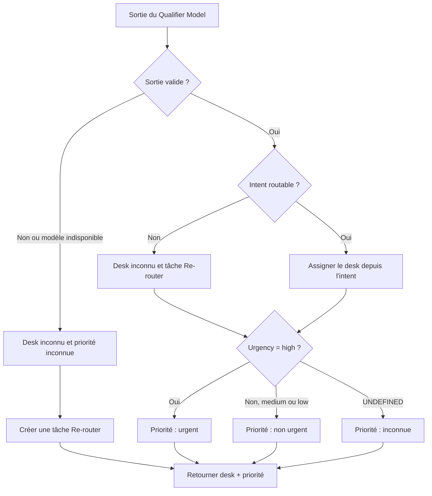

# Arbre de décision du Routing Node

Cet arbre décrit la décision initiale du Router : desk, Re-router et priorité. Le protocole historique du Qualifier et les seuils de gouvernance restent définis dans [`scoring_protocol.md`](../../agentic-workflow-subproject/docs/scoring_protocol.md) et [`governance.md`](../../governance.md).

**Intents routables :** `payment_status` → payments ; `dispute` → disputes ; `technical_api` → technical/API ; `compliance` → compliance. `UNDEFINED`, `OTHER` et tout intent non mappé déclenchent Re-router.

Un intent non routable conserve la priorité extraite si la sortie est valide : un ticket urgent reste visible pendant le Re-router. Une sortie invalide ou indisponible a une priorité inconnue, sauf signal indépendant approuvé par la politique et tracé avec sa provenance. Le `sub_intent` est transmis sans changer la décision. Le Re-router et le Validator sont les deux interventions humaines du flux ; une urgence seule n'arrête pas la préparation d'un brouillon.

## Scoring avant mise en service

Le scoring sur validation/test compare les modèles sur les mêmes tickets et une référence indépendante. `val` sert aux réglages ; la comparaison finale sur `test_natural` suit la règle déjà fixée dans le protocole historique, sans réajuster le modèle après lecture du test. Le scorer historique du Qualifier conserve ses métriques, ses règles de comparaison et ses seuils : cette lecture Router s'ajoute sans les redéfinir.

| But | Mesures minimales |
|---|---|
| Décision initiale | Exactitude de l'action (`bon desk` ou `Re-router`) / tous les tickets ; matrice référence × action avec les quatre desks et Re-router. |
| Utilité et abstention | Couverture automatique = desk assigné / tous les tickets ; Re-router inutile = référence à un desk connu mais Re-router / tous les tickets. |
| Erreur grave de desk | Vrai urgent assigné automatiquement au mauvais desk / tous les vrais urgents, avec nombre brut ; Re-router ne compte pas comme mauvais desk. |
| Urgence manquée | Vrai urgent dont la priorité finale initiale est `medium`, `low` ou `unknown` / tous les vrais urgents, avec nombre brut et sous-compte `unknown`. |

La matrice se lit aussi sur le seul sous-ensemble des vrais urgents. Les deux erreurs graves peuvent se chevaucher : ne pas additionner leurs taux. Montrer également les urgents envoyés au Re-router et les faux `high` comme diagnostics de charge, sans en faire de nouveaux seuils bloquants.

Le protocole historique du **Qualifier seul** suit desk accuracy ≥ 90 %, couverture ≥ 50 %, zéro urgent automatiquement au mauvais desk et sa règle de comparaison des modèles. Le garde-fou urgent de D-q4 échoue (1/167). La proposition de 0,1 % dans la gouvernance vise les **erreurs graves incrémentales atteignant les marchands après le flux complet**, versus un contrôle ; elle ne s'applique pas aux 0,7 % d'erreurs silencieuses du modèle seul. Son dénominateur et son protocole restent à approuver. Le passage du Router requiert les cas déterministes de la spec et une évaluation sur références adaptées au flux ; les seuils de risque produit encore ouverts relèvent de Support/Compliance. Le poids historique de 10 points est une hypothèse de benchmark, pas un coût métier validé.

## Monitoring après mise en service

À l'inférence, on connaît la prédiction et les événements du flux, mais pas automatiquement la bonne réponse. Precision, rappel, exactitude et matrice de confusion exigent des étiquettes de référence ; elles ne se calculent pas de façon fiable à partir des seules prédictions.

| Type | À suivre dans les événements de production |
|---|---|
| Direct, à chaque inférence | Erreurs/indisponibilité, validité du contrat, latence, versions modèle/schéma/règle ; volumes par intent, desk, priorité et Re-router. |
| Flux humain | Corrections du Re-router, corrections du Validator, reprises de brouillon, âge du ticket et attente de l'urgent ; conserver décision initiale et décision corrigée. |
| Différé, sur échantillon vérifié | Réannoter desk/action et urgence ; recalculer matrice, urgents au mauvais desk et urgences manquées avec nombres et dénominateurs, par version et segment. |

Une correction humaine est un signal de monitoring utile, mais elle ne constitue une référence de vérité que si elle est enregistrée comme telle et contrôlée. Suivre les mesures initiales du Router séparément des résultats corrigés par le Re-router/Validator. Surveiller les versions et les tendances dans le temps ; alerter sur les seuils approuvés, sans inventer de seuils de production dans le code.
