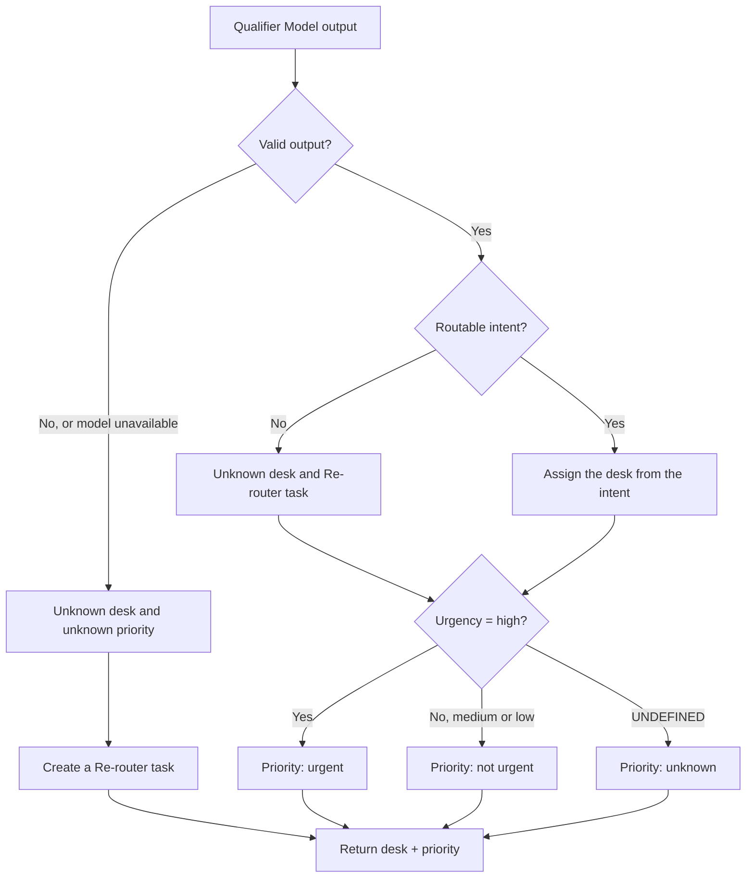

# Routing Node decision tree

This tree describes the Router's initial decision: desk, Re-router and priority. The historical Qualifier protocol and the governance thresholds remain defined in [`scoring_protocol.md`](../../agentic-workflow-subproject/docs/scoring_protocol.md) and [`governance.md`](../../governance.md).

**Routable intents:** `payment_status` → payments; `dispute` → disputes; `technical_api` → technical/API; `compliance` → compliance. `UNDEFINED`, `OTHER` and any unmapped intent trigger the Re-router.

A non-routable intent keeps the extracted priority if the output is valid: an urgent ticket stays visible while it is with the Re-router. An invalid or unavailable output has an unknown priority, unless an independent signal is approved by the policy and traced with its provenance. The `sub_intent` is passed on without changing the decision. The Re-router and the Validator are the two human interventions of the flow; urgency alone never stops the preparation of a draft.

## Scoring before go-live

Scoring on validation/test compares the models on the same tickets against an independent reference. `val` is used for tuning; the final comparison on `test_natural` follows the rule already fixed in the historical protocol, without re-tuning the model after reading the test. The historical Qualifier scorer keeps its metrics, comparison rules and thresholds: this Router reading is added without redefining them.

| Goal | Minimum measures |
|---|---|
| Initial decision | Action accuracy (`right desk` or `Re-router`) / all tickets; reference × action matrix with the four desks and the Re-router. |
| Usefulness and abstention | Automatic coverage = desk assigned / all tickets; needless Re-router = reference to a known desk but sent to the Re-router / all tickets. |
| Serious desk error | True urgent ticket automatically assigned to the wrong desk / all true urgent tickets, with raw count; the Re-router does not count as a wrong desk. |
| Missed urgency | True urgent ticket whose initial final priority is `medium`, `low` or `unknown` / all true urgent tickets, with raw count and an `unknown` sub-count. |

The matrix is also read on the subset of true urgent tickets only. The two serious errors may overlap: do not add their rates. Also show urgent tickets sent to the Re-router and false `high` as workload diagnostics, without turning them into new blocking thresholds.

The historical **Qualifier-only** protocol tracks desk accuracy ≥ 90 %, coverage ≥ 50 %, zero urgent tickets automatically on the wrong desk, and its model comparison rule. The D-q4 urgent guardrail fails (1/167). Passing the Router requires the deterministic cases of the spec and an evaluation on references suited to the flow; the product risk thresholds still open belong to Support/Compliance. The historical weight of 10 points is a benchmark assumption, not a validated business cost.

## Monitoring after go-live

At inference time, we know the prediction and the flow events, but not automatically the right answer. Precision, recall, accuracy and the confusion matrix require reference labels; they cannot be computed reliably from predictions alone.

| Type | To track in production events |
|---|---|
| Direct, at every inference | Errors/unavailability, contract validity, latency, model/schema/rule versions; volumes by intent, desk, priority and Re-router. |
| Human flow | Re-router corrections, Validator corrections, draft rework, ticket age and urgent waiting time; keep the initial decision and the corrected decision. |
| Deferred, on a verified sample | Re-label desk/action and urgency; recompute the matrix, urgent tickets on the wrong desk and missed urgencies with counts and denominators, by version and segment. |

A human correction is a useful monitoring signal, but it is a ground-truth reference only if it is recorded as such and checked. Track the Router's initial measures separately from the results corrected by the Re-router/Validator. Monitor versions and trends over time; alert on approved thresholds, without inventing production thresholds in code.
