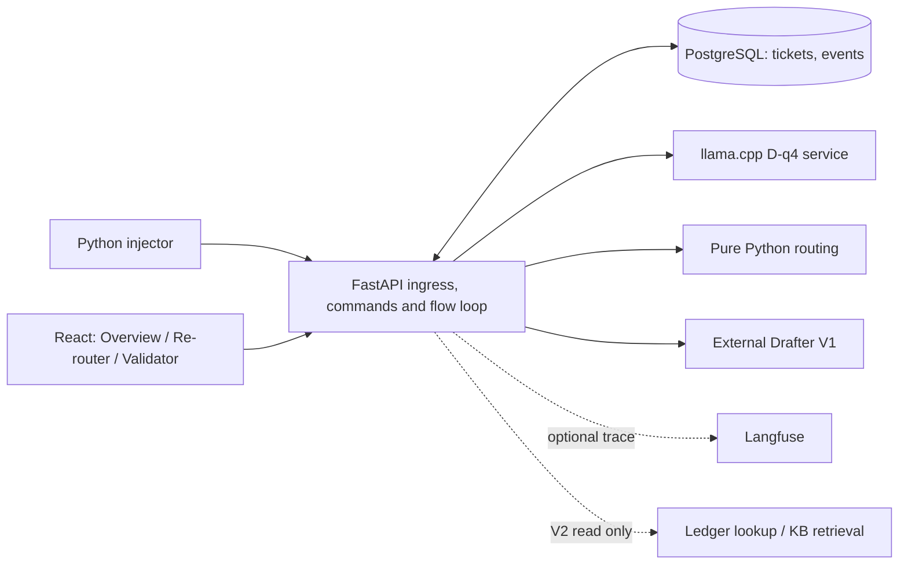

# Technical implementation plan — integrated demo

Status: proposed implementation choices, 5 November 2026, simplified after the [flow script](../012-flow-script/plan.md) decision. V1 has no separate worker, no leases, no claims and no optimistic versions. Product requirements and acceptance criteria: [spec.md](spec.md); execution checklist: [tasks.md](tasks.md); router: [feature 004](../004-routing-node/plan.md); parallel study: [feature 011](../011-confidence-signals/plan.md). No service is implemented or deployed by this plan.

All runtime, frontend, demo and research code belongs inside `agentic-workflow-subproject/`. Pipeline steps live in `flow/`; the API and persistence wrap them when the front end needs shared state. The front end stays in `frontend/`. The empty `backend/` and `demo/` scaffolds are not a commitment. Organize notebooks by research topic and use `research/{qualifier,drafter,confidence}` for topic-specific research code. Qualifier research code lives in `research/qualifier/`. Maintain one authoritative seven-field contract; do not silently duplicate it.

## Proposed stack and choices

| Layer | Proposed default | Purpose and decision boundary |
|---|---|---|
| API and orchestration | Python, FastAPI, Pydantic, SQLAlchemy, Alembic | Typed HTTP commands and responses, schema validation, database transactions and migrations. Python runtime version pinned for the new service; keep heavy model dependencies isolated. |
| Background processing | One loop inside the API process reads pending tickets from the database; plain Python orchestration | A single consumer needs no lease. After a restart, pending tickets are picked up again. LangGraph/LangChain are not required for V1; revisit for V2 tools if the triggers in the flow plan appear. |
| Database | PostgreSQL locally and in cloud | Same transaction and concurrency semantics in both environments; Docker Compose volume locally, managed external PostgreSQL candidate in cloud. Compare actual cost before selection. |
| Qualifier | Existing D-q4 GGUF via llama.cpp server, HTTP adapter | Isolate model lifecycle from API; validate existing seven-string schema and preserve raw output. Verify artifact provenance, CPU memory, cold start, concurrency and transport; use a deterministic fake adapter for tests only. |
| Routing | Existing feature 004 pure Python contract | One versioned policy and reason codes; the API owns side effects and persistence. |
| Drafter V1 | Configurable external model API, server-side adapter | Direct generation with synthetic text and safe available context, timeout, retry limit, usage/cost tracking and manual fallback. Provider/model and budget remain open; no tools in V1. |
| Front | React + TypeScript + Vite, static build | Three workspaces, typed API client, accessible tables and forms, consistent functional design. Poll backend initially; use server-sent events only if polling proves insufficient. No business policy or secrets in browser. |
| Demo injection | Python CLI using HTTP client | Select dataset split/case/seed; bounded replay with 30/60-second configurable cadence, immediate injection and idempotency keys. May run locally against cloud API. |
| Local delivery | Docker Compose: API, PostgreSQL, Qualifier; static front dev/build | Reproducible startup, volume, health checks, configuration and teardown. Keep the large model artifact outside Git and mount it locally; document its source and checksum. |
| Cloud candidate | Cloud Run API, Cloud SQL PostgreSQL candidate, static GitHub Pages or Cloudflare Pages | Requires feasibility/cost spike before provider selection. The background loop needs one instance kept alive with CPU allocated during the demo, then teardown. Model service may need a separate instance. |
| Observability | Backend events/metrics + Langfuse | Backend is source of truth for queues and cumulative counters; Langfuse is a best-effort trace sink. Synthetic data only, credentials server-side. |
| V2 tools | Read-only SQL lookup + document retrieval behind typed interfaces | Synthetic merchant-scoped fixtures and versioned KB; simple retrieval first, vector RAG only after measured benefit. Neither tool writes, sends, or grants routing authority. |

These are planning defaults, not already-installed dependencies. Confirm runtime compatibility, provider limits, cloud access and budget before implementation/deployment; replace a choice if the feasibility spike fails and document why.

## Boundaries and data flow

The API persists a pending ticket before acknowledging ingress. The flow loop writes outcomes and events transactionally. The client never supplies trusted route decisions or sends directly. Model calls run outside DB transactions; their results are committed only if the ticket's session still matches.

## Initial contracts to freeze before coding

- **Ingress**: `POST /tickets` with ticket text, synthetic merchant context, dataset split/row reference, session ID and idempotency key; server assigns ID and timestamp. Expected labels are held in a separate evaluation-only mapping, never sent to Qualifier, Router or Drafter. Same key and same payload returns existing result; a conflicting payload returns a conflict.
- **Reads**: `GET /tickets`, `GET /tickets/{id}`, `GET /tickets/{id}/events`, `GET /queues/{name}` and `GET /metrics` provide pagination, ordering, explicit state and period/denominator. Final names are contract decisions, not implemented endpoints.
- **Commands**: route correction, draft edit, handoff, approve/simulated send, controlled retry and demo reset include actor/session identity; invalid commands return actionable errors. Send is idempotent and requires server-side gates.
- **Records**: ticket, session, qualifier output plus validation/version, routing decision/reasons, draft/version/source references, human action, event and simulated send. Add unique constraints for idempotency; append events in the same transaction as transitions. Store synthetic-only text with configured retention.
- **Reset**: increment the session ID. Results from an older session are dropped before being written; old tickets leave active queues without deleting cumulative event history, and the new session starts with 3–4 deterministic identified seeds. A repeated reset is idempotent through a request key. Historical metrics include seeded ingress and explicitly label seed inclusion, period and denominator; current queue counts only include active generation.
- **Metric semantics**: received = distinct ingress events; processed = tickets that reached a defined completed processing outcome (final definition fixed in contract); auto-assignment = automatically assigned initial desk / all initial assignment decisions; reroute = distinct tickets handed to or corrected by Re-router, explicitly separate both definitions and counts. Track events rather than inferring correctness from low correction rates. Exclude duplicates and report no-denominator states.

## Delivery stages and gates

0. **Flow script**: deliver [feature 012](../012-flow-script/plan.md). Gate: real D-q4, routing and direct Drafter work locally with failures visible. Issues #33, #34, #36.
1. **Contracts and fixtures**: finalize state machine, event schema, API examples, reset semantics, policy version and 3–4 seed scenarios. Agree on stale-version and recovery cases. Gate: representative success, ambiguity, reset and failure cases are reviewable before implementation. Issues #30, #34.
2. **Runtime skeleton**: create API, migration and flow loop around the flow functions; implement idempotent ingress, persistent events and session reset. Gate: duplicate ingress, restart, stale result and reset checks pass. Issues #30–#32.
3. **Human actions**: expose reroute, edits and explicit idempotent simulated send through the API. Gate: complete local happy path plus provider failure and stale drafts. Issues #31, #36.
4. **Front and demo controls**: implement Re-router, Validator and Overview against API; injector single/replay commands; current vs cumulative metrics and confirmation for reset. Gate: demonstrate 3–4 seeded cases, injections at selected cadence, keyboard primary flows, correction and review; queues and metrics reconcile across restart/reset. Issues #32, #37–#38.
5. **Docker and local acceptance**: Compose images/services, migrations, model setup, health checks, configuration example and smoke/teardown guide. Gate: documented clean-machine run uses real D-q4, persists data through restart, handles provider failure and completes simulated send. Issue #39.
6. **Cloud feasibility and deployment**: measure artifact packaging, startup, CPU/memory, background execution, durable store and expected minimum/idle costs. Select host and budget, authorize billable resources, configure secrets/access/CORS and deploy. Gate: actual URL, real inference, reset, persistence, end-to-end workflow, cost and teardown verified; otherwise document limitation/fallback. Issue #40.
7. **Monitoring and evaluation**: Langfuse starts in feature 012; instrument throughout earlier stages, then add labelled replay scoring; show latency, errors, routing/re-routing counts and denominators. Gate: offline labels do not enter model prompts, events reconcile with Overview, trace outage does not break processing and scores include split/version/denominator. Issues #41–#42.
8. **V2 tools**: synthetic merchant-isolated ledger and approved KB, read-only typed tools, then agentic orchestration if useful; compare simple retrieval with embeddings before RAG. Gate: wrong-merchant, ambiguity, missing source and tool errors verified. Issues #35, #43.

Stages 2–4 can overlap only after their contracts are agreed; the confidence study may start in parallel. The local vertical slice (0–5) does not wait for cloud, RAG or the confidence study. Course requirements and readiness evidence remain tracked in #16, #19, #21, #22 and #44.

## Test strategy and unresolved decisions

Use table-driven router cases; API/database integration tests for idempotency, session reset and atomic send; restart recovery tests; adapter contract tests and one real-model smoke; browser end-to-end tests for the three workspaces. Test synthetic fixture isolation and unsupported facts. Record latency and estimated cost with configuration. Do not repeatedly consume the locked test set to tune policies.

Open: three models for confidence study, provider/API model and spending cap, cloud project and host, budget/idle-cost tolerance, demo access control, exact reset seed scenarios, schema migrations/retention and allowed course data/evaluation requirements. Technical choices above remain proposals until assessed against these constraints.
